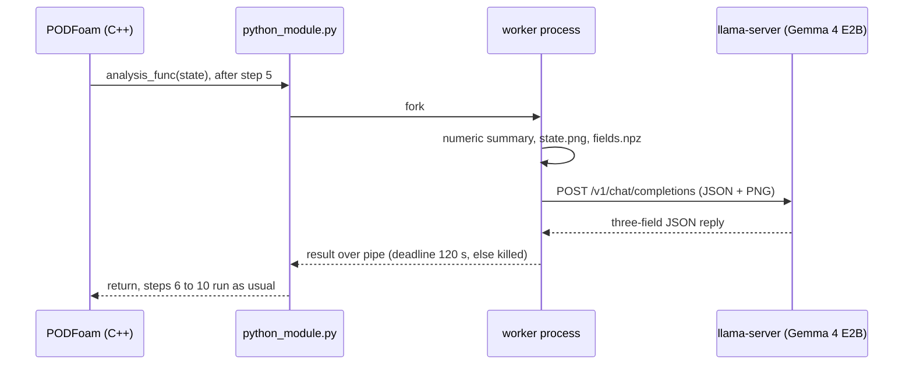

# PythonFOAM + Gemma 4 E2B: reading solver state during a run

[](https://github.com/seungminyome/PythonFOAM/actions/workflows/tests.yml)
[](https://github.com/seungminyome/PythonFOAM/actions/workflows/evidence.yml)


[](LICENSE)

[October 20 report](docs/results-20261020.md) · [October 17 report](docs/results.md) · [Evidence](docs/evidence/README.md) · [How to run](Solver_Examples/PODFoam/llm_demo/README.md) · [Korean](https://github.com/seungminyome/PythonFOAM-Korean)

During a PODFoam run, a callback sends one step's numbers and a velocity/pressure
image, or several images from along the run, to Gemma 4 E2B running on the
local CPU, stores the answer and lets the solver continue. The request can be
asynchronous: the solver keeps stepping and the answer is recorded when it
arrives. That much works. Nothing from the model goes back into the
computation. The answers themselves are not usable yet: asked where the
fastest flow is, or how the flow changes between snapshots, the model is
wrong in nearly every case tested.


*The image sent at step 5 of the October 17 run: |U| on top, kinematic pressure p below (640x360, one polygon per cell).*

## Quick start

Unit tests, no OpenFOAM or model needed (about 10 s):

```bash
pip install -r Solver_Examples/PODFoam/llm_demo/requirements.txt
make test          # or: cd Solver_Examples/PODFoam/llm_demo && python3 -m unittest
make evidence      # every evidence file matches its manifest hash
```

Full run (OpenFOAM v2106, about 3.4 GB of disk for the model files, a few GB of RAM):

```bash
cd Solver_Examples/PODFoam
./validation/run_v2106.sh        # bridge check; its passed run is the reference case
./llm_demo/setup_runtime.sh      # Gemma 4 E2B Q4_0, image projector, llama.cpp b11429
python3 llm_demo/runtime.py start
./llm_demo/run_demo.sh           # builds PODFoam, runs the five cases, verifies
python3 llm_demo/runtime.py stop
```

Details and environment variables: [llm_demo/README.md](Solver_Examples/PODFoam/llm_demo/README.md).

## Implementation



- A Python callback added to PODFoam (OpenFOAM v2106). Right after a chosen
  time step it sends residuals, Courant number, continuity error, an SVD summary
  and a PNG of that step's |U| and p to a local llama.cpp server (Gemma 4 E2B
  Q4_0 with image projector) and stores the response. "Step 5" in this document
  is the fifth of the ten time steps (t = 5×10⁻⁷ s), the default; set
  `LLM_ANALYSIS_STEP` to change it.
- Three request modes (`LLM_MODE`): `observe` (numbers plus the image, the
  original), `describe` (one image; a description and the positions of the
  fastest flow and the lowest pressure as percent of the plotted ranges) and
  `sequence` (images captured at `LLM_SEQUENCE_STEPS`, sent together at the
  last one; how the flow changes, with fixed trend words). `LLM_IMAGE_XRANGE`
  plots a window of the domain instead of all of it.
- Synchronous by default: the solver waits for the reply or a deadline. With
  `LLM_ASYNC=1` the request step only forks the worker; every later step polls
  it without blocking, the reply is recorded with the step at which it
  arrived, a worker past its deadline is killed, and at most one request is in
  flight. At the last step a pending reply is waited for, or detached.
- If the server is absent or slow, the solver is never blocked beyond the
  deadline, in either mode.
- Verification scripts check that all steps completed, that every written
  field file is identical to a run without requests, that logs match the
  records, that the frames' arrays equal the written fields, and that the
  image hashes match the request body.
- The October 17 measurements used revision `23089bb`; the October 20
  measurements used `9449085`, which added the modes, the asynchronous path
  and the plot window.

## Measurements (2026-10-20, asynchronous runs and replays)

3000 steps of 5×10⁻⁷ s, same machine and server. Each case once.

| Run | Request at step | Reply recorded at step | Solver wait at the request step | Model wait | Files equal to baseline |
|---|---:|---:|---:|---:|---:|
| No request (baseline) | 1250 | 1261 | 0.004 s | - | - |
| Describe one image | 250 | 1093 | 0.006 s | 34.0 s | 216 / 216 |
| Sequence of three images | 1250 | 2321 | 0.004 s | 43.4 s | 216 / 216 |
| Connection refused | 250 | 280 | 0.004 s | 0.002 s | 216 / 216 |
| Server made to stall (4 s deadline) | 250 | 353 | 0.004 s | killed at 4.0 s | 216 / 216 |

Every other step's callback took under 0.005 s. Both replies arrived while
the solver was still running (843 and 1071 steps after the request). The
model waits are shorter than on October 17 because the system prompts were
already in the server's cache.

Replays of saved frames, three repeats each, two views (whole domain and a
window around the step):

| Question | Frames | Result |
|---|---|---|
| Where is the fastest flow? (percent of the plotted range) | 3 states × 2 views | 18 answers, none within 10 % of the true spot; 14 to 18 % off in the whole-domain view (0.27 to 0.39 m), 50 to 80 % off in the window |
| How does the flow change? (trend words) | 3 frames × 2 views | Peak speed called `increasing` in both views while it falls from 60 to 47 (42) m/s; 1 of 3 words right in the whole-domain view, 2 of 3 in the window |

Details, the model's texts and the caveats are in the
[October 20 report](docs/results-20261020.md).

## Measurements (2026-10-17, run `pod-llm-demo.LRfJBN`)

8 vCPU, 7.7 GiB RAM, no GPU; llama-server on 4 threads, llama.cpp
b11429, context 2048. 20,540 cells, time step
10⁻⁷ s, ten steps. Each condition was run once on this date. A repeat on
October 19 gave the same answers and the same step-5 hashes
([details](docs/results.md#repeat-on-2026-10-19)).

| Condition | Result | Steps | Files equal to baseline | Callback time |
|---|---|---:|---:|---:|
| No model request | baseline | 10 | - | 0.493 s |
| Numbers + image | answer stored | 10 | 45 / 45 | 78.256 s |
| Numbers only | answer stored | 10 | 45 / 45 | 39.672 s |
| Connection refused | error stored, run continues | 10 | 45 / 45 | 0.509 s |
| Server made to stall (4 s deadline) | timeout stored, run continues | 10 | 45 / 45 | 4.013 s |

Callback time is measured in C++ from just before the Python analysis call to
just after it returns. Of the 78.256 s in the image condition, rendering took
0.438 s and waiting for the model 77.560 s.

Using the saved step-5 state, the model was asked three paired times (six
requests) with the question, numbers and settings fixed and only the PNG added
or removed. The maximum speed, 82.53 m/s, was in the input for both conditions;
its location was not. The reference is cell 12090 at (0.0005, 0.0127) m.

| Condition | Claimed (x, y) m | In-plane error | Outcome |
|---|---|---:|---|
| Numbers only | (0.6012, 0.1143) | 60.92 cm | wrong in all 3 |
| Numbers + image | (0.5, 0.1143) | 50.97 cm | wrong in all 3 |

The numbers-only answers copied the domain's x and y upper bounds from the
input as the location. The image answers were about 10 cm closer and still
wrong.

## Open problems

1. Answer accuracy. On three states and two views the model never placed the
   fastest flow within 10 % of the plotted range, and it called the peak
   speed increasing while the colour bars show it falling. With this model
   the descriptions are not usable.
2. Cost measurement. Latencies depend on the server's prompt cache (26 to
   33 s for one image with a cold image, 15 s warm; 11 to 45 s for three),
   so the cost of an image is still not isolated.
3. Scope. One serial fluid case (a backward-facing step at start-up), one
   request in flight at a time. MPI, 3D, the 12B model and the contribution
   of the SVD summary have not been tested.

## Next steps

1. Run the describe and sequence replays, and the asynchronous suite, with
   Gemma 4 12B QAT on a GPU node and put E2B and 12B in one table. Scripts
   for the server are in [llm_demo/hpc/](Solver_Examples/PODFoam/llm_demo/hpc/README.md);
   the replay commands are in the [October 20 report](docs/results-20261020.md).
2. Try a picture the model can read: larger, with grid lines and labelled
   ticks, or a single panel; test with the same replay scripts.
3. Allow more than one request in flight and a request every N steps, and
   measure memory and the pipe traffic over a long run.
4. Re-measure the time cost of the image under controlled cache conditions.

## Repository layout

```
Solver_Examples/PODFoam/      PODFoam solver (OpenFOAM v2106) with the callback hooks
  validation/                 bridge check: ten steps, SVD round trip, verify.py
  llm_demo/                   callback module, llama-server client, five-case runners (sync and async),
                              replay benchmarks (paired, describe, sequence), unit tests, requirements.txt
docs/results-20261020.md      October 20 report: asynchronous runs, describe and sequence replays
docs/evidence/2026-10-20/     records of the October 20 runs and replays, hash manifest
docs/results.md               October 17 test report
docs/evidence/2026-10-17/     raw requests, responses, logs, verification, hash manifest
docs/evidence/2026-10-13/     earlier run (pod-llm-demo.SwwR2e) and its report, docs/results-20261013.md
docs/evidence/2026-10-19/     repeat of the October 17 run (pod-llm-demo.o5sNLJ), same answers and hashes
docs/evidence/check_manifest.py  verifies every evidence file against its manifest (also run in CI)
docs/upstream-project.md      original PythonFOAM README (other solvers, Docker, build notes)
.github/workflows/            tests.yml (unit tests, Python 3.10 and 3.12), evidence.yml (hashes, links)
CHANGELOG.md, Makefile
```

Other directories (`APMOSFoam`, `AEFoam`, `PINNFoam`, `TurbulenceModel_Examples`,
`Handson_Examples`) are unchanged from upstream.

## More

- [October 20 report](docs/results-20261020.md): asynchronous runs, one-snapshot and sequence replays, caveats
- [October 17 report](docs/results.md): synchronous conditions, paired image/no-image replay
- [Evidence](docs/evidence/README.md): raw requests and responses, logs, verification results, hash manifests
- Full run downloads: [October 20](https://github.com/seungminyome/PythonFOAM/releases/tag/pod-insitu-async-2026-10-20), [October 17](https://github.com/seungminyome/PythonFOAM/releases/tag/pod-insitu-tests-2026-10-17) (all saved results and the executed sources, no model weights)
- [Changelog](CHANGELOG.md)
- [Korean repository](https://github.com/seungminyome/PythonFOAM-Korean) and its [illustrated results](https://seungminyome.github.io/PythonFOAM-Korean/)

## Acknowledgements and license

This extends the PODFoam example of [PythonFOAM](https://github.com/argonne-lcf/PythonFOAM)
(Argonne National Laboratory). The original description and setup notes are in
the [project reference](docs/upstream-project.md). The model is served with
[llama.cpp](https://github.com/ggml-org/llama.cpp). The [license](LICENSE) is unchanged.
