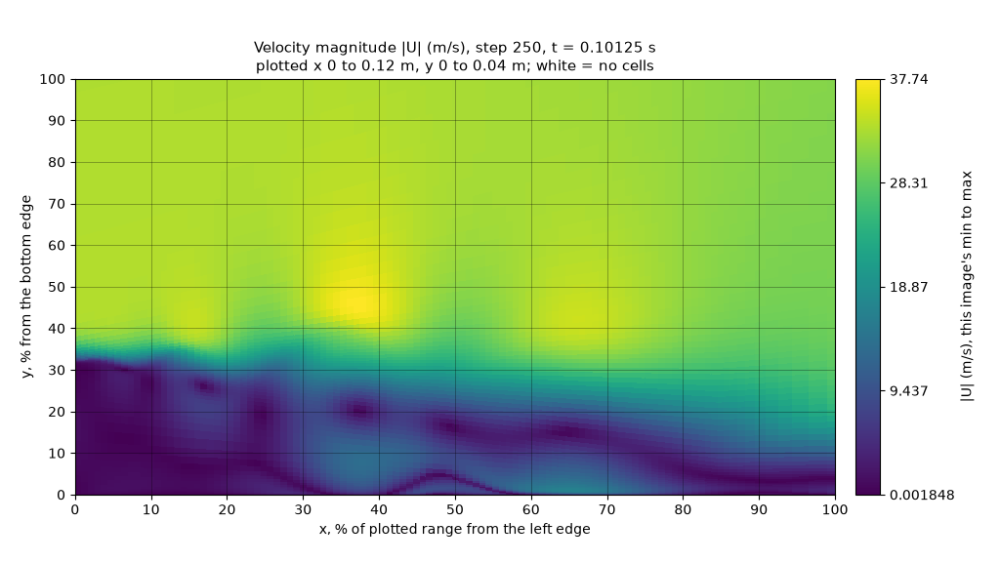
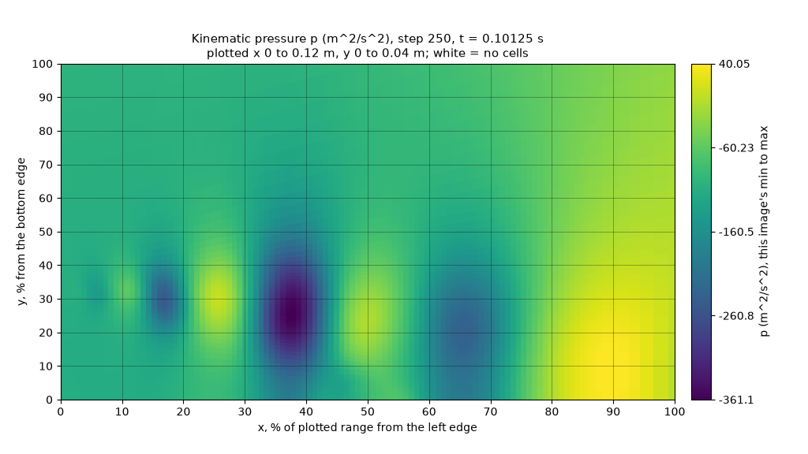
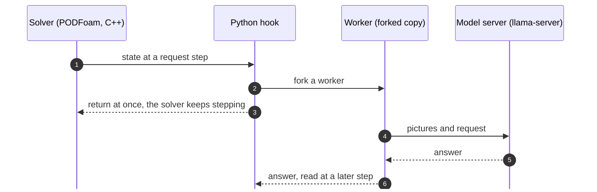

# PythonFOAM: a vision-language observer for OpenFOAM runs

[](https://github.com/seungminyome/PythonFOAM/actions/workflows/tests.yml)
[](https://github.com/seungminyome/PythonFOAM/actions/workflows/evidence.yml)


[](LICENSE)

[Results page](https://seungminyome.github.io/PythonFOAM/) · [Latest report](docs/results-20261103.md) · [How to run](Solver_Examples/PODFoam/llm_demo/README.md) · [GPU nodes](Solver_Examples/PODFoam/llm_demo/hpc/README.md) · [Korean](https://github.com/seungminyome/PythonFOAM-Korean)

While OpenFOAM runs, Python draws the flow and asks a local picture-reading model
what it sees. This fork of [PythonFOAM](https://github.com/argonne-lcf/PythonFOAM)
adds this observer to its PODFoam example, in `Solver_Examples/PODFoam/`. The model
runs under [llama.cpp](https://github.com/ggml-org/llama.cpp) on the same machine, and
nothing it says goes back into the solver. The tests below show what such a model can
and cannot read from solver pictures.

## What we found

The model was Google's Gemma 4 12B unless a row says otherwise. It got a question
together with the pictures below, |U| and p of one time step, or with a short sequence
of them.

| Question | What happened | Verdict |
|---|---|---|
| Where is the flow fastest, and where is the pressure lowest? | In most pictures it points at the right spot, more often than a fixed guess does. | Works |
| Does the picture style matter? | Yes. With one field per picture and axes in percent, four models placed both the fastest flow and the lowest pressure in 45 to 48 of 48 pictures. With the solver's original two-panel picture they placed each in 2 to 17. | A lot |
| Can it do that while the solver is running? | Yes. The test sent a request every 250 steps. These requests add under 1 % to the run time of the same run with no model requests. The solver wrote identical files in both runs. | Works |
| Between snapshots, is the flow speeding up or slowing down? | It reads a change in peak speed of 2 % or more. It misreads most smaller changes. | Works for clear changes |
| Is this run about to crash? | It warns at most five steps before the crash. Simple rules on the field values do as well or better. | No early warning |
| Was this run set up wrong? | In a first test, the lead of Gemma 4 31B over a simple rule came from two runs. A second, stricter test with 29 pairs of runs shows no lead over a regression on the colour-bar numbers and the stated setup. 31B catches more wrong runs but also calls normal runs wrong. | No lead shown |
| Does a bigger model help? | The small Gemma 4 E2B model does not read these pictures reliably. 12B is enough for positions. 31B sees small pressure spots better, but at judging a setup it shows no lead over a simple rule or a regression. | Partly |

The fixed guess is the best single answer given to every picture. The four models are
Gemma 4 12B, 26B-A4B and 31B, and Qwen3.5-35B-A3B.

The exact counts and the baselines are on the
[results page](https://seungminyome.github.io/PythonFOAM/) and in the reports it lists.
The models' answers are in the [evidence folders](docs/evidence/README.md) and in the
releases they link, and each folder has a hash manifest.

 

*What the model sees: |U| and p of step 250 of a developed backward-facing-step
flow, drawn by the running solver and sent to Gemma 4 12B.*

All tests used 2D laminar flows and one extruded 3D case, so other flows may read
differently. Only positions and words from a fixed list
are scored; the free-text descriptions are not.

## How it works

The solver calls a Python hook, `analysis_func` in `python_module.py`, once per time
step. The diagram shows one request in the asynchronous mode, `LLM_ASYNC=1`. Time runs
from top to bottom. Solid arrows send something, and dashed arrows bring something back.
At arrow 3 the solver goes on with the next time step and does not wait for the model.



The worker draws |U| and p and posts them to llama-server, the HTTP server of llama.cpp.
The answer is recorded together with the arrays the pictures came from. The
synchronous mode is the default. In it the solver waits for the answer instead, with a deadline of 120 s unless set otherwise.

Requests go out once or every N steps. Up to eight requests can wait for an answer at
a time. MPI runs gather the fields to the master rank, and 3D meshes are drawn through a
plane slice. [llm_demo/README.md](Solver_Examples/PODFoam/llm_demo/README.md) describes
the request modes `observe`, `describe` and `sequence`, the two picture styles and every
setting.

## Quick start

Unit tests and evidence hashes need neither OpenFOAM nor a model:

```bash
pip install -r Solver_Examples/PODFoam/llm_demo/requirements.txt
make test          # 177 tests, about 2 minutes
make evidence      # every file in a manifest matches its hash
```

The commands below check the C++ to Python bridge, then run and verify five PODFoam
cases with the small Gemma 4 E2B model on the CPU. They need OpenFOAM v2012, v2106,
v2212 or 8 sourced and Python 3.10 to 3.12. The downloads are the model, its image
projector and llama.cpp, about 3.4 GB in all. No token is needed:

```bash
export PYTHON=${PYTHON:-$(command -v python3)}   # or the path of another Python
export PATH=$(dirname "$PYTHON"):$PATH
export LD_LIBRARY_PATH=$(dirname "$PYTHON")/../lib:$LD_LIBRARY_PATH   # if not the system Python
cd Solver_Examples/PODFoam
./validation/run.sh              # checks the C++ to Python bridge; its run is the suite's reference
./llm_demo/setup_runtime.sh      # Gemma 4 E2B Q4_0, image projector, llama.cpp b11429
python3 llm_demo/runtime.py start
./llm_demo/run_demo.sh           # builds PODFoam, runs the five cases, verifies
python3 llm_demo/runtime.py stop
```

[llm_demo/hpc/README.md](Solver_Examples/PODFoam/llm_demo/hpc/README.md) describes the
scripts for a Slurm GPU node, where the reports ran the larger models.

## Reports

Each report records the setup, hardware, code revision and Slurm jobs of its runs.

- [November 3](docs/results-20261103.md): wrong-setup test 2, the model against
  baselines that read the same pictures, in 29 pairs of runs.
- [November 2](docs/results-20261102.md): the PR branches on four OpenFOAM versions,
  why OpenFOAM 8 differs from v2212, 3D slice pictures, the instability test without
  stated times.
- [October 30](docs/results-20261030.md): OpenFOAM versions, a comparison with the
  original PODFoam, the first wrong-setup test.
- [October 28](docs/results-20261028.md): two requests in flight, 3D slices, the
  instability test.
- Earlier reports, October 13 to 27: on the
  [results page](https://seungminyome.github.io/PythonFOAM/#reports).
- [Evidence index](docs/evidence/README.md) · [Changelog](CHANGELOG.md).

## Where the code is

The observer lives in `Solver_Examples/PODFoam/`: the `Python*.H` hooks and
`llm_demo/`. Branch `pr/podfoam-fix` holds the fixes alone, and `pr/podfoam-observer`
adds the hooks and the observer. Both fix a bug in the original PODFoam, where the next
snapshot overwrote the first snapshot of each SVD window. The fix for this bug is also
in `PODFoam_Debug`, `APMOSFoam` and `AEFoam`, and the other examples are as in
argonne-lcf/PythonFOAM. The
[November 2 report](docs/results-20261102.md) says what the fix changes.
[HOOKS.md](Solver_Examples/PODFoam/HOOKS.md) describes the two optional hooks,
`analysis_func` and `mesh_func`. The
[validation README](Solver_Examples/PODFoam/validation/README.md) describes the bridge
check.

## Citation

If you use the observer, please cite PythonFOAM and this repository:

```bibtex
@article{maulik2022pythonfoam,
  title   = {PythonFOAM: In-situ data analyses with OpenFOAM and Python},
  author  = {Maulik, Romit and Fytanidis, Dimitrios K. and Lusch, Bethany and
             Vishwanath, Venkatram and Patel, Saumil},
  journal = {Journal of Computational Science},
  volume  = {62},
  pages   = {101750},
  year    = {2022},
  doi     = {10.1016/j.jocs.2022.101750}
}

@software{yome2026observer,
  author = {Yome, Seungmin},
  title  = {PythonFOAM: a vision-language observer for OpenFOAM runs},
  year   = {2026},
  url    = {https://github.com/seungminyome/PythonFOAM}
}
```

## Acknowledgements

This repository extends the PODFoam example of [PythonFOAM](https://github.com/argonne-lcf/PythonFOAM)
by Argonne National Laboratory. PythonFOAM's original description and setup notes are
in the [project reference](docs/upstream-project.md). The models are served
with [llama.cpp](https://github.com/ggml-org/llama.cpp). The model weights
are not part of this repository and come with their own licences. The GPU
and CPU-node runs in the reports used the MedicineBow cluster of the
University of Wyoming Advanced Research Computing Center.

## License

The PythonFOAM open-source [license](LICENSE) of UChicago Argonne, LLC
applies unchanged.
