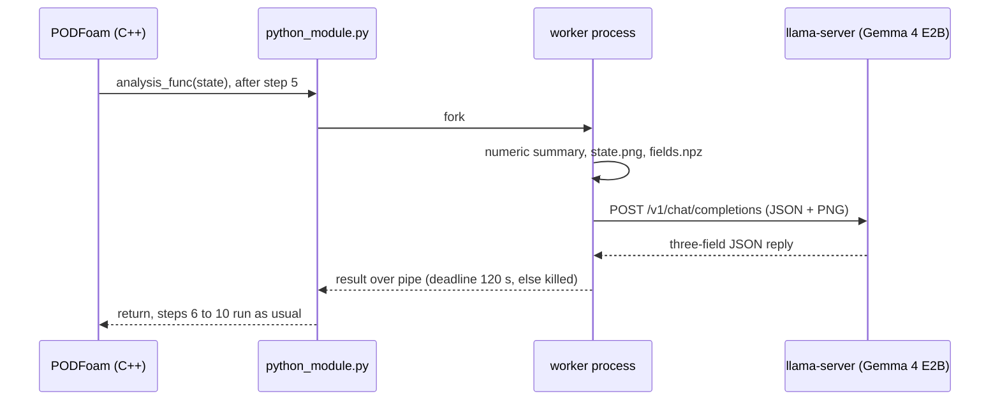

# PythonFOAM + Gemma 4 E2B: reading solver state during a run

[](https://github.com/seungminyome/PythonFOAM/actions/workflows/tests.yml)
[](https://github.com/seungminyome/PythonFOAM/actions/workflows/evidence.yml)


[](LICENSE)

[October 22, continued](docs/results-20261022-live.md) · [October 22 report](docs/results-20261022.md) · [October 20 report](docs/results-20261020.md) · [October 17 report](docs/results.md) · [Evidence](docs/evidence/README.md) · [How to run](Solver_Examples/PODFoam/llm_demo/README.md) · [Korean](https://github.com/seungminyome/PythonFOAM-Korean)

During a PODFoam run, a callback sends one step's numbers and a velocity/pressure
image, or several images from along the run, to a vision-language model served
by llama.cpp, stores the answer and lets the solver continue. The request can be
asynchronous: the solver keeps stepping and the answer is recorded when it
arrives. That much works. Nothing from the model goes back into the
computation. Gemma 4 E2B on the CPU, the original setup, gives answers that are
not usable. With the solver drawing pictures meant to be read (one field per
image, axes in percent with a grid; `LLM_IMAGE_STYLE=v2`) and Gemma 4 12B on a
GPU node, eleven requests from a running solver, each with its own plotted
window, placed the fastest flow within 10 % of the plotted range 9 times and
the lowest pressure 10 times, where one fixed answer would be right 4 times;
the written flow fields stayed identical to a run without requests
([October 22, continued](docs/results-20261022-live.md)). How the flow
changes over time is not read reliably yet.


*The image sent at step 5 of the October 17 run: |U| on top, kinematic pressure p below (640x360, one polygon per cell).*

## Quick start

Unit tests, no OpenFOAM or model needed (92 tests, about 45 s):

```bash
pip install -r Solver_Examples/PODFoam/llm_demo/requirements.txt
make test          # or: cd Solver_Examples/PODFoam/llm_demo && python3 -m unittest
make evidence      # every evidence file matches its manifest hash
```

Full run (OpenFOAM v2106, about 3.4 GB of disk for the model files, a few GB of RAM):

```bash
cd Solver_Examples/PODFoam
./validation/run_v2106.sh        # bridge check; its passed run is the reference case
./llm_demo/setup_runtime.sh      # Gemma 4 E2B Q4_0, image projector, llama.cpp b11429
python3 llm_demo/runtime.py start
./llm_demo/run_demo.sh           # builds PODFoam, runs the five cases, verifies
python3 llm_demo/runtime.py stop
```

Details and environment variables: [llm_demo/README.md](Solver_Examples/PODFoam/llm_demo/README.md).

## Implementation



- A Python callback added to PODFoam (OpenFOAM v2106; on October 22 also v2212
  in an Apptainer image on a GPU node). Right after a chosen
  time step it sends residuals, Courant number, continuity error, an SVD summary
  and a PNG of that step's |U| and p to a local llama.cpp server (Gemma 4 E2B
  Q4_0 with image projector) and stores the response. "Step 5" in this document
  is the fifth of the ten time steps (t = 5×10⁻⁷ s), the default; set
  `LLM_ANALYSIS_STEP` to change it.
- Three request modes (`LLM_MODE`): `observe` (numbers plus the image, the
  original), `describe` (one image; a description and the positions of the
  fastest flow and the lowest pressure as percent of the plotted ranges) and
  `sequence` (images captured at `LLM_SEQUENCE_STEPS`, sent together at the
  last one; how the flow changes, with fixed trend words). `LLM_IMAGE_XRANGE`
  plots a window of the domain instead of all of it.
- Synchronous by default: the solver waits for the reply or a deadline. With
  `LLM_ASYNC=1` the request step only forks the worker; every later step polls
  it without blocking, the reply is recorded with the step at which it
  arrived, a worker past its deadline is killed, and at most one request is in
  flight. At the last step a pending reply is waited for, or detached.
- If the server is absent or slow, the solver is never blocked beyond the
  deadline, in either mode.
- Verification scripts check that all steps completed, that every written
  field file is identical to a run without requests, that logs match the
  records, that the frames' arrays equal the written fields, and, for the
  synchronous image cases and the asynchronous sequence case, that the image
  hashes match the request body.
- `readable_image.py` draws one field per picture, axes in percent of the
  plotted range with a grid line every 10 % and the colour bar labelled with
  five values from the minimum to the maximum (v2). With `LLM_IMAGE_STYLE=v2`
  the callback draws these pictures for `describe` and `sequence` requests and
  builds the request with `readable_request.py`, the code the picture tests
  use; each live request body is checked to equal that builder applied to the
  frame on disk, byte for byte. The default is still the two-panel picture of
  `pod_image.py` (v1). `LLM_LONG_START` starts the asynchronous cases from a
  developed flow state; `run_live_sweep.py` adds describe requests at several
  steps, each with its own random window; `window_test.py` builds picture sets
  with random windows.
- The October 17 measurements used revision `23089bb`; the October 20
  measurements used `9449085`, which added the modes, the asynchronous path
  and the plot window. The October 19 12B replay ran from `934da23`, whose
  request and scoring code equal `23089bb`. The October 22 picture test ran
  from `58e00d9`; the later October 22 runs from `354caf9` with uncommitted
  changes, published in `dee7731` with a review's fixes
  ([records](docs/results-20261022-live.md#records)).

## Measurements (2026-10-22, v2 pictures from the running solver)

PODFoam in OpenFOAM v2212 (Apptainer image) on a MedicineBow GPU node, Gemma 4
12B QAT on the node's NVIDIA RTX A6000 (Slurm job 24757460), v2 pictures. Every
case started from t = 0.1 s of a developed flow, with vortices rolling up
behind the step, and ran 6000 steps of 5×10⁻⁶ s.

| Run | Request at step | Reply recorded at step | Solver wait at the request step | Model wait | Files equal to baseline |
|---|---:|---:|---:|---:|---:|
| Describe one snapshot | 250 | 320 | 0.004 s | 3.17 s | 432 / 432 |
| Sequence of three snapshots | 3750 | 3823 | 0.004 s | 3.15 s | 432 / 432 |
| Connection refused | 250 | 261 | 0.004 s | 0.011 s | 432 / 432 |
| Server made to stall (4 s deadline) | 250 | 324 | 0.004 s | killed at the 4 s deadline | 432 / 432 |

The describe answer put the fastest flow 3.3 % and the lowest pressure 5.0 %
of the plotted range from the true cells. The sequence answer had the falling
peak speed and the moving fastest flow right and the pressure trend wrong.
Eleven more describe requests, at steps 500 to 5500 and each with its own
random window, all arrived while the solver ran (69 to 93 steps later), and
each body equalled the tested builder applied to the frame; 9 of 11
fastest-flow and 10 of 11 lowest-pressure answers were within 10 %, where one
fixed answer gets 4 and 4. In a shorter trial run the describe answer was 33 %
and 29 % off.

In the picture test repeated with the plotted window placed at random around
the fastest cell (one fixed answer: 7 to 10 of 48), 12B, 26B-A4B, 31B and
Qwen3.5-35B-A3B placed both extremes within 10 % in 45 to 48 of 48 v2
pictures for each of three window seeds, and in 2 to 17 of 48 with v1. In 35
states of the developed flow (one fixed answer: 16 and 17 of 140) they placed
the lowest pressure within 10 % in 130 to 139 of 140 v2 pictures and the
fastest flow in 106 to 121; most fastest-flow misses named another spot with
at least 90 % of the largest speed.

## Measurements (2026-10-22, picture-reading test on a GPU node)

The same 308 prepared requests, nearly all about pictures, sent to each of
seven Gemma 4 models in turn on one NVIDIA RTX A6000 (MedicineBow, Slurm job
24756981), llama.cpp b11429, temperature 0. No solver ran. v1 is the picture
the solver sends (two panels, axes in metres), v2 the new one (one field per
image, axes in percent with a grid line every 10 %). Synthetic: 32 pictures
with one bright |U| spot and one dark p spot. Planted: 32 pictures of 4 saved
states, each with a narrow |U| peak and p dip added. Right means within 10 %
of the plotted range.

| Model | Synthetic, fastest flow, v1 / v2 | Planted, fastest flow, v1 / v2 | Planted, lowest p, v1 / v2 | Median time per request |
|---|---:|---:|---:|---:|
| E2B Q4_0 (the solver's model; timed here on the GPU) | 4 / 11 | 2 / 10 | 3 / 6 | 1.01 s |
| E4B QAT | 9 / 15 | 4 / 15 | 4 / 5 | 1.31 s |
| 12B QAT | 9 / 32 | 5 / 32 | 9 / 25 | 2.86 s |
| 26B-A4B QAT | 17 / 32 | 15 / 31 | 5 / 20 | 2.18 s |
| 31B QAT | 18 / 32 | 17 / 32 | 9 / 24 | 6.33 s |
| One fixed answer | 5 | 6 | 6 | |

Out of 32. Every planted lowest-pressure miss of 12B, 26B-A4B and 31B named
the step corner, where the state without the dip has its own lowest pressure.
On 12 synthetic three-time sequences with a clear change, the same three
models called the peak-speed trend right in 12 of 12 when each image's colour
bar printed its own maximum, and in 5 to 10 when one colour scale was shared;
the 2 % threshold for "roughly constant" was not in the prompt, so the six
flat designs are not a fair test. In the saved flow without planted features
the extremes stay at the step corner and the trend words barely vary, so one
fixed answer already scores 24 of 24 positions; there, with numbers on the
colour bars, 26B-A4B and 31B read the pressure trend right in 11 and 12 of 14
sequences, 12B in 3. Two more E2B forms (BF16 projector, QAT weights) and the October 17
and 20 requests are in the [October 22 report](docs/results-20261022.md).

## Measurements (2026-10-20, asynchronous runs and replays)

3000 steps of 5×10⁻⁷ s, same machine and server. Each case once.

| Run | Request at step | Reply recorded at step | Solver wait at the request step | Model wait | Files equal to baseline |
|---|---:|---:|---:|---:|---:|
| Model off (baseline: request built, not sent) | 1250 | 1261 | 0.004 s | - | - |
| Describe one image | 250 | 1093 | 0.006 s | 34.0 s | 216 / 216 |
| Sequence of three images | 1250 | 2321 | 0.004 s | 43.4 s | 216 / 216 |
| Connection refused | 250 | 280 | 0.005 s | 0.002 s | 216 / 216 |
| Server made to stall (4 s deadline) | 250 | 353 | 0.005 s | killed at the 4 s deadline | 216 / 216 |

The callback took 0.008 to 0.019 s at the step at which a reply or error was
recorded (the solver waits for the child that writes the result files), about
0.1 s at the last step and at most 0.0052 s at every other step; a whole run
took about 0.05 s per step. Both replies arrived while the
solver was still running (843 and 1071 steps after the request). The model
waits are shorter than on October 17 mainly because the prompts are shorter
(570 and 907 tokens against 1541); 266 and 273 of those tokens were also still
in the server's cache from a trial run a few minutes earlier.

Replays of saved frames, three repeats each, two views (whole domain and a
window around the step):

| Question | Frames | Result |
|---|---|---|
| Where is the fastest flow? (percent of the plotted range) | 3 states × 2 views | 18 answers (6 frames, 3 repeats each), none within 10 % of the true spot; 14 to 18 % off in the whole-domain view (0.27 to 0.39 m), 50 to 80 % off in the window |
| How does the flow change? (trend words) | 3 frames × 2 views | Peak speed called `increasing` in both views while it falls from 60 to 47 (42) m/s; 1 of 3 words right in the whole-domain view, 2 of 3 in the window |

Details, the model's texts and the caveats are in the
[October 20 report](docs/results-20261020.md).

## Measurements (2026-10-19, Gemma 4 12B on a GPU node)

The October 17 paired replay (below) sent again with only the model name
changed: Gemma 4 12B QAT Q4_0 with its image projector on one NVIDIA A30
(MedicineBow, Slurm job 24696203), llama.cpp b11429 built from source with
CUDA, all layers on the GPU, context 2048.

| Model, machine | Condition | Position given | Error | Time per request |
|---|---|---|---:|---:|
| E2B, CPU, Oct 17 | Numbers only | (0.6012, 0.1143) m, all 3 | 60.92 cm | 14.5 to 55.6 s |
| E2B, CPU, Oct 17 | Numbers + image | (0.5, 0.1143) m, all 3 | 50.97 cm | 13.2 to 20.8 s |
| 12B, A30, Oct 19 | Numbers only | "unknown", all 3 | not scored | 2.0 to 3.3 s |
| 12B, A30, Oct 19 | Numbers + image | "unknown", all 3 | not scored | 2.1 to 2.7 s |

"Unknown" is not a zero error. The image answers add, as a possible
interpretation, high velocity "near x=0.00 m" (true x = 0.0005 m) with no y,
which the scorer does not read; two numbers-only answers blamed "the image"
although none was sent. The speed difference mixes model size, GPU against
CPU and a fresh server against a warm one. Details: [October 17 report](docs/results.md#same-replay-with-gemma-4-12b-on-a-gpu-2026-10-19),
[evidence](docs/evidence/2026-10-19-12b/README.md).

## Measurements (2026-10-17, run `pod-llm-demo.LRfJBN`)

8 vCPU, 7.8 GiB RAM, no GPU; llama-server on 4 threads, llama.cpp
b11429, context 2048. 20,540 cells, time step
10⁻⁷ s, ten steps. Each condition was run once on this date. A repeat on
October 19 gave the same step-5 hashes, the same image reply and the same
replay coordinates; the numbers-only reply and the wording of five replay
answers changed ([details](docs/results.md#repeat-on-2026-10-19)).

| Condition | Result | Steps | Files equal to baseline | Callback time |
|---|---|---:|---:|---:|
| No model request | baseline | 10 | - | 0.493 s |
| Numbers + image | answer stored | 10 | 45 / 45 | 78.256 s |
| Numbers only | answer stored | 10 | 45 / 45 | 39.672 s |
| Connection refused | error stored, run continues | 10 | 45 / 45 | 0.509 s |
| Server made to stall (4 s deadline) | timeout stored, run continues | 10 | 45 / 45 | 4.013 s |

Callback time is measured in C++ from just before the Python analysis call to
just after it returns. Of the 78.256 s in the image condition, rendering took
0.438 s and waiting for the model 77.560 s.

Using the saved step-5 state, the model was asked three paired times (six
requests) with the question, numbers and settings fixed and only the PNG added
or removed. The maximum speed, 82.53 m/s, was in the input for both conditions;
its location was not. The reference is cell 12090 at (0.0005, 0.0127) m.

| Condition | Claimed (x, y) m | In-plane error | Outcome |
|---|---|---:|---|
| Numbers only | (0.6012, 0.1143) | 60.92 cm | wrong in all 3 |
| Numbers + image | (0.5, 0.1143) | 50.97 cm | wrong in all 3 |

The numbers-only answers copied the domain's x and y upper bounds from the
input as the location. The image answers were about 10 cm closer and still
wrong.

## Open problems

1. Answer accuracy. With E2B, the default model, the descriptions are not
   usable. With v2 pictures, 12B and larger models place the fastest flow and
   the lowest pressure within 10 % in most pictures, also with random windows
   and from a running solver (9 and 10 of 11). How the flow changes is not
   read reliably: the live sequence answer had the pressure trend wrong, and
   in replays 12B read the saved flow's pressure trend the wrong way round in
   11 of 14 sequences. Two of eleven live positions were off where the picture
   had two similar extremes or a near-uniform bright region.
2. Cost measurement. Latencies depend on the server's prompt cache (26 to
   33 s for one image with only the first 266 tokens cached, 14 to 18 s with
   nearly all cached; 11 to 45 s for three), so the time cost of an image is
   still not isolated.
3. Scope. One serial 2D laminar case (a backward-facing step, from start-up
   to a developed flow with shedding), one request in flight at a time, each
   live case run once. MPI, 3D, other cases and the contribution of the SVD
   summary have not been tested.

## Next steps

1. Ask for trends with the 2 % threshold in the prompt, on sequences of the
   developed flow, where the trend words vary.
2. Allow more than one request in flight and a request every N steps, and
   measure memory and the pipe traffic over a long run.
3. Compare model families at equal settings (Qwen with its recommended image
   tokens, 4-bit files for both).
4. Prepare the callback hooks, the v2 pictures and request builder, the
   asynchronous path and their tests as a contribution to PythonFOAM.
5. Re-measure the time cost of the image under controlled cache conditions.
   Scripts for the GPU nodes are in [llm_demo/hpc/](Solver_Examples/PODFoam/llm_demo/hpc/README.md).

## Repository layout

```
Solver_Examples/PODFoam/      PODFoam solver (OpenFOAM v2106, also built in v2212) with the callback hooks
  validation/                 bridge check: ten steps, SVD round trip, verify.py
  llm_demo/                   callback module, llama-server client, v2 picture and request builder, five-case runners (sync and async),
                              describe sweep, replay benchmarks (paired, describe, sequence), picture-reading and random-window tests,
                              unit tests, requirements.txt
  llm_demo/hpc/               Slurm scripts for GPU nodes: the 12B paired replay, the picture tests and the v2 solver run (all run on MedicineBow)
docs/results-20261022-live.md October 22, continued: v2 pictures from the running solver, random windows, Qwen models
docs/evidence/2026-10-22-live-v2/       its solver run (Slurm job 24757460): frames, bodies, replies, logs, check script, hash manifest
docs/evidence/2026-10-22-window-test/   its picture tests (six Slurm jobs) and the developed flow: answers, keys, recount, hash manifest
docs/results-20261022.md      October 22 report: picture-reading test, seven Gemma 4 models, two picture styles
docs/evidence/2026-10-22-picture-test/  its records (Slurm job 24756981), answer key, independent re-scoring, hash manifest
docs/results-20261020.md      October 20 report: asynchronous runs, describe and sequence replays
docs/evidence/2026-10-20/     records of the October 20 runs and replays, hash manifest
docs/results.md               October 17 test report
docs/evidence/2026-10-17/     raw requests, responses, logs, verification, hash manifest
docs/evidence/2026-10-13/     earlier run (pod-llm-demo.SwwR2e) and its report, docs/results-20261013.md
docs/evidence/2026-10-19/     repeat of the October 17 run (pod-llm-demo.o5sNLJ), same hashes and replay coordinates
docs/evidence/2026-10-19-12b/ paired replay with Gemma 4 12B on an NVIDIA A30 (Slurm job 24696203), hash manifest
docs/evidence/check_manifest.py  verifies every evidence file against its manifest (also run in CI)
docs/upstream-project.md      original PythonFOAM README (other solvers, Docker, build notes)
.github/workflows/            tests.yml (unit tests, Python 3.10 and 3.12), evidence.yml (hashes, links)
CHANGELOG.md, Makefile
```

Other directories (`APMOSFoam`, `AEFoam`, `PINNFoam`, `TurbulenceModel_Examples`,
`Handson_Examples`) are unchanged from upstream.

## More

- [October 22, continued](docs/results-20261022-live.md): v2 pictures from the running solver with 12B, random windows, a developed flow, Qwen models
- [October 22 report](docs/results-20261022.md): picture-reading test, seven Gemma 4 models from E2B to 31B, two picture styles
- [October 20 report](docs/results-20261020.md): asynchronous runs, one-snapshot and sequence replays, caveats
- [October 17 report](docs/results.md): synchronous conditions, paired image/no-image replay
- [12B replay](docs/results.md#same-replay-with-gemma-4-12b-on-a-gpu-2026-10-19): the October 17 paired requests, Gemma 4 12B on a GPU node
- [Evidence](docs/evidence/README.md): raw requests and responses, logs, verification results, hash manifests
- Picture test downloads: [October 22](https://github.com/seungminyome/PythonFOAM/releases/tag/picture-test-2026-10-22) (the 308 requests with their answer key, the random-window sets, and every reply of the seven jobs)
- v2 solver run downloads: [October 22](https://github.com/seungminyome/PythonFOAM/releases/tag/pod-insitu-v2-2026-10-22) (every written time directory of the five cases and the eleven sweep cases, the trial run, the developed flow and the job records)
- Full run downloads: [October 20](https://github.com/seungminyome/PythonFOAM/releases/tag/pod-insitu-async-2026-10-20), [October 17](https://github.com/seungminyome/PythonFOAM/releases/tag/pod-insitu-tests-2026-10-17) (all saved results of the five-case runs and the executed sources, no model weights; the time directories of the October 20 windowed frame run are not included)
- [Changelog](CHANGELOG.md)
- [Korean repository](https://github.com/seungminyome/PythonFOAM-Korean) and its [illustrated results](https://seungminyome.github.io/PythonFOAM-Korean/)

## Acknowledgements and license

This extends the PODFoam example of [PythonFOAM](https://github.com/argonne-lcf/PythonFOAM)
(Argonne National Laboratory). The original description and setup notes are in
the [project reference](docs/upstream-project.md). The model is served with
[llama.cpp](https://github.com/ggml-org/llama.cpp). The [license](LICENSE) is unchanged.
