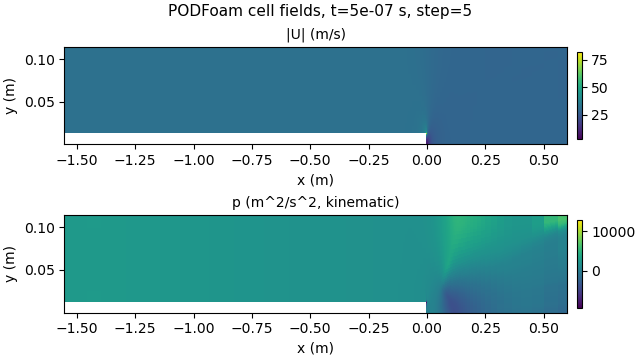

# PythonFOAM: in-situ observer/logger

This fork adds a PythonFOAM callback-based in-situ **observer/logger** to the PODFoam example. During a run, the solver passes a numerical summary and a same-step velocity/pressure image to a local multimodal model, records the response, and resumes calculation. Model output does not change solver fields, settings or control algorithms. The recorded run used Gemma.

**[Project overview and illustrated guides](https://seungminyome.github.io/PythonFOAM/)** · **[Run report](docs/results.md)** · **[Saved data](docs/evidence/README.md)** · **[Code and execution instructions](Solver_Examples/PODFoam/llm_demo/README.md)**

## Recorded result

The 2026-10-13 run (`pod-llm-demo.SwwR2e`) used a serial, 20,540-cell case. It queried the model after step 5 and completed all 10 steps. Four comparison cases each produced 45 output files byte-identical to the no-request baseline.

| Case | Outcome | Full callback time |
|---|---|---:|
| No model request | Baseline; image rendered locally | 0.755 s |
| Numbers and image | Actual model response | 70.604 s |
| Numbers only | Actual model response | 41.412 s |
| Connection refused | Returned to calculation | 0.411 s |
| Deliberately delayed response | Timed out; returned to calculation | 4.017 s |

The callback is synchronous: the solver waits. These are single-run measurements, not averages. Identical output files show that the observer did not alter the saved results in these tests; they do not prove numerical stability for other cases or physical accuracy.

The model quoted the supplied maximum speed correctly but misplaced the high-speed location. The actual maximum is at x ≈ 0.000538 m; the answer referred to x = 0.25 m. The minimum-pressure cell is nearby but is **not the same cell**. A large pressure gradient was not independently established by this comparison.

This result verifies the connection and the tested recovery paths. It does not establish physical accuracy, reliable model analysis, failure prediction, or an isolated benefit from adding an image.



*Actual input image. The vertical axis is stretched; the displayed shape is not to scale.*

## Read or download

| Material | Link |
|---|---|
| Short illustrated overview, Korean | [Read in browser](https://seungminyome.github.io/PythonFOAM/overview.ko.html) |
| Detailed guide: SVD/POD, results, limitations, review questions | [Read in browser](https://seungminyome.github.io/PythonFOAM/guide.ko.html) |
| Selected original data with an in-page reader | [Open evidence reader](https://seungminyome.github.io/PythonFOAM/guide.ko.html#raw-library) |
| Offline guides | [Download HTML bundle](https://github.com/seungminyome/PythonFOAM/releases/download/pod-insitu-demo-2026-10-13/explanations-ko.zip) |
| Selected evidence | [Download evidence ZIP](https://github.com/seungminyome/PythonFOAM/releases/download/pod-insitu-demo-2026-10-13/evidence-swwr2e.zip) |
| Complete saved run, including all five case directories | [Download run archive](https://github.com/seungminyome/PythonFOAM/releases/download/pod-insitu-demo-2026-10-13/run-archive-SwwR2e.tar.gz) |
| Download checksums | [SHA256SUMS.txt](https://github.com/seungminyome/PythonFOAM/releases/download/pod-insitu-demo-2026-10-13/SHA256SUMS.txt) |

The HTML guides contain their selected evidence and work offline after download. The complete run archive is separate. No model weights are included.

## Reproduce or inspect

Start with the [PODFoam bridge validation](Solver_Examples/PODFoam/validation/README.md), then follow the [local-model demo instructions](Solver_Examples/PODFoam/llm_demo/README.md). The tested environment was OpenFOAM v2106, Python 3.10, NumPy, matplotlib, and a local CPU llama.cpp server running `gemma-4-E2B-it-Q4_0-vision`.

To inspect the existing run without executing CFD or the model, unpack the complete run archive and run:

```bash
python3 Solver_Examples/PODFoam/llm_demo/verify_demo.py /path/to/pod-llm-demo.SwwR2e
```

This check requires NumPy. Details of the request, response, field comparisons and read-only recheck are in the [run report](docs/results.md).

A local [controlled replay benchmark](Solver_Examples/PODFoam/llm_demo/README.md#controlled-replay-benchmark) prepares numeric-only and numeric-plus-image requests with identical questions, summaries and generation settings. Its default mode sends no requests. It is a benchmark setup, not a new model-quality result or a new solver run.

## Upstream project

PythonFOAM connects OpenFOAM with Python for in-situ analysis. This fork builds on [argonne-lcf/PythonFOAM](https://github.com/argonne-lcf/PythonFOAM). The original project description, other solver examples and setup notes are retained in [the project reference](docs/upstream-project.md).

The integration remains under the repository's [Argonne open-source license](LICENSE).
