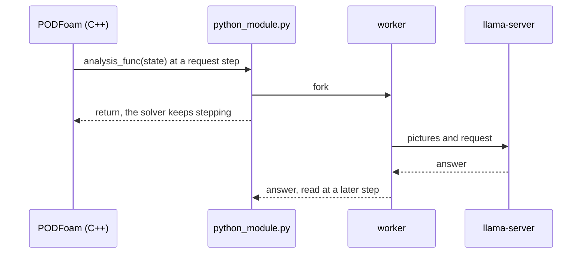

# PythonFOAM: a vision-language observer for OpenFOAM runs

[](https://github.com/seungminyome/PythonFOAM/actions/workflows/tests.yml)
[](https://github.com/seungminyome/PythonFOAM/actions/workflows/evidence.yml)


[](LICENSE)

[Results page](https://seungminyome.github.io/PythonFOAM/) · [Latest report](docs/results-20261103.md) · [How to run](Solver_Examples/PODFoam/llm_demo/README.md) · [GPU nodes](Solver_Examples/PODFoam/llm_demo/hpc/README.md) · [Korean](https://github.com/seungminyome/PythonFOAM-Korean)

While OpenFOAM runs, Python draws the flow and asks a local picture-reading model
what it sees. This repository shows what such a model can and cannot read from
solver pictures. It builds on the PODFoam example of
[PythonFOAM](https://github.com/argonne-lcf/PythonFOAM); the model runs under
[llama.cpp](https://github.com/ggml-org/llama.cpp) on the same machine, and nothing
it says goes back into the solver.

## What we found

The model was Gemma 4 12B unless a row names another size. It got two pictures of one
time step, |U| and p, or a short sequence of them for the trend and crash questions,
and a question.

| Question | What happened | Verdict |
|---|---|---|
| Where is the flow fastest, and where is the pressure lowest? | In most pictures it points at the right spot. On 140 windows cut at random from a developed flow it is right 108 times for the fastest flow and 130 for the lowest pressure; the constant baseline, one fixed answer for every picture, gets 16 and 17. On the 24 slice frames the solver drew, the constant baseline did as well or better. | Works |
| Can it do that while the solver is running? | Yes. A request every 250 steps adds 0.7 % to the run time beyond drawing the pictures, and all 2,016 field files it wrote equal those of the run without requests. | Works |
| Between snapshots, is the flow speeding up or slowing down? | It reads the peak-speed trend when the change is 2 % or more, 29 of 30 times; the pressure trend less often, 28 of 38. | Works for clear changes |
| Is this run about to crash? | It says so one step before the crash, when the field has already blown up, and never more than 5 steps ahead. A simple rule on the numbers does as well or better. | No |
| Was this run set up wrong? | In a first test 31B looked promising. A second test with 29 pairs of runs and the plan fixed before any request shows no lead of 31B over a regression on the colour-bar numbers. 31B catches more wrong runs but calls 11 of 29 normal runs wrong. | Not shown |
| Does a bigger model help? | The small E2B model gives no usable answers. 12B is enough for positions. 31B finds a small pressure spot in 38 of 40 pictures of the flow past a cylinder where 12B finds 18, and it beat 12B in the first wrong-setup test. The second test ran 31B alone, and there it did no better than the regression on the colour-bar numbers. | Partly |

Every row rests on recorded runs with their counts; the scored rows also have a
baseline. The [results page](https://seungminyome.github.io/PythonFOAM/) has them, and
the [evidence folders](docs/evidence/README.md) hold the raw answers with hash manifests.

 

*What the model sees: |U| and p of step 250 of a developed backward-facing-step
flow, drawn by the running solver and sent to Gemma 4 12B.*

Two things to keep in mind. All tests used 2D laminar flows and one extruded 3D
case, so other flows may read differently. Only positions and fixed words are
scored; the free-text descriptions are not.

## How it works

The solver calls a Python hook once per time step. At a request step the hook forks
a worker, which draws the pictures and posts them to llama-server, the HTTP server
of llama.cpp. The solver keeps stepping, and the answer is read and recorded at a
later step together with the arrays it came from.



The requests can be synchronous or asynchronous, once or every N steps, with up to
eight unanswered at a time. MPI runs gather the fields to the master rank, and 3D meshes are
drawn through a plane slice. The three request modes, the two picture styles and
every setting are in [llm_demo/README.md](Solver_Examples/PODFoam/llm_demo/README.md).

## Quick start

Unit tests and evidence hashes need neither OpenFOAM nor a model:

```bash
pip install -r Solver_Examples/PODFoam/llm_demo/requirements.txt
make test          # 177 tests, about 2 minutes
make evidence      # every file in a manifest matches its hash
```

With an OpenFOAM sourced (v2012, v2106, v2212 or 8) and Python 3.10 to 3.12, the
five-case suite with the small Gemma 4 E2B model on the CPU exercises the coupling
and the verification. The downloads, the model, its image projector and llama.cpp,
are about 3.4 GB, and no token is needed:

```bash
export PYTHON=${PYTHON:-$(command -v python3)}   # or the path of another Python
export PATH=$(dirname "$PYTHON"):$PATH
export LD_LIBRARY_PATH=$(dirname "$PYTHON")/../lib:$LD_LIBRARY_PATH   # if not the system Python
cd Solver_Examples/PODFoam
./validation/run.sh              # checks the C++ to Python bridge; its run is the suite's reference
./llm_demo/setup_runtime.sh      # Gemma 4 E2B Q4_0, image projector, llama.cpp b11429
python3 llm_demo/runtime.py start
./llm_demo/run_demo.sh           # builds PODFoam, runs the five cases, verifies
python3 llm_demo/runtime.py stop
```

The GPU runs of the reports, Gemma 4 12B to 31B on a Slurm node, are in [llm_demo/hpc/README.md](Solver_Examples/PODFoam/llm_demo/hpc/README.md).

## Reports

Each report records the setup, hardware, code revision and Slurm jobs of its runs.

- [November 3](docs/results-20261103.md): wrong-setup test 2, 29 pairs of runs
  against rules on the same pictures.
- [November 2](docs/results-20261102.md): the PR branches on four OpenFOAM versions,
  why OpenFOAM 8 differs, 3D slice pictures, the crash test without times.
- [October 30](docs/results-20261030.md): OpenFOAM versions, the original PODFoam,
  the first wrong-setup test.
- [October 28](docs/results-20261028.md): two requests in flight, 3D slices, the
  crash test.
- [Evidence index](docs/evidence/README.md) · [Changelog](CHANGELOG.md).

## Where the code is

The observer lives in `Solver_Examples/PODFoam/`: the `Python*.H` hooks and
`llm_demo/`. The other examples are as in argonne-lcf/PythonFOAM. Branch
`pr/podfoam-fix` holds the PODFoam fix alone, and `pr/podfoam-observer` adds the hooks
and the observer. The [November 2 report](docs/results-20261102.md) says what the fix
changes. [HOOKS.md](Solver_Examples/PODFoam/HOOKS.md) describes the
two hooks and the [validation README](Solver_Examples/PODFoam/validation/README.md)
the bridge check.

## Citation

If you use the observer, please cite PythonFOAM and this repository:

```bibtex
@article{maulik2022pythonfoam,
  title   = {PythonFOAM: In-situ data analyses with OpenFOAM and Python},
  author  = {Maulik, Romit and Fytanidis, Dimitrios K. and Lusch, Bethany and
             Vishwanath, Venkatram and Patel, Saumil},
  journal = {Journal of Computational Science},
  volume  = {62},
  pages   = {101750},
  year    = {2022},
  doi     = {10.1016/j.jocs.2022.101750}
}

@software{yome2026observer,
  author = {Yome, Seungmin},
  title  = {PythonFOAM: a vision-language observer for OpenFOAM runs},
  year   = {2026},
  url    = {https://github.com/seungminyome/PythonFOAM}
}
```

## Acknowledgements

This extends the PODFoam example of [PythonFOAM](https://github.com/argonne-lcf/PythonFOAM)
by Argonne National Laboratory; its original description and setup notes are
in the [project reference](docs/upstream-project.md). The models are served
with [llama.cpp](https://github.com/ggml-org/llama.cpp); the model weights
are not part of this repository and come with their own licences. The GPU
and CPU-node runs in the reports used the MedicineBow cluster of the
University of Wyoming Advanced Research Computing Center.

## License

The PythonFOAM open-source [license](LICENSE) of UChicago Argonne, LLC
applies unchanged.
