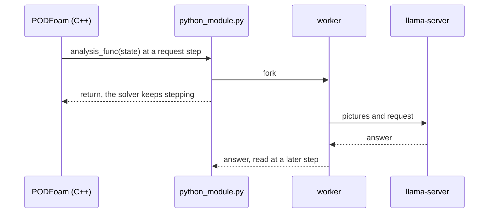

# PythonFOAM: a vision-language observer for OpenFOAM runs

[](https://github.com/seungminyome/PythonFOAM/actions/workflows/tests.yml)
[](https://github.com/seungminyome/PythonFOAM/actions/workflows/evidence.yml)


[](LICENSE)

[Results page](https://seungminyome.github.io/PythonFOAM/) · [Latest report](docs/results-20261102.md) · [How to run](Solver_Examples/PODFoam/llm_demo/README.md) · [GPU nodes](Solver_Examples/PODFoam/llm_demo/hpc/README.md) · [Korean](https://github.com/seungminyome/PythonFOAM-Korean)

This fork of [PythonFOAM](https://github.com/argonne-lcf/PythonFOAM) adds an
optional observer to the PODFoam example. During an OpenFOAM run the solver hands
its state to Python. Python draws |U| and p and asks a vision-language model, a
model that reads pictures and text, to describe them. The model runs locally under
[llama.cpp](https://github.com/ggml-org/llama.cpp). The answers are recorded with the
arrays they came from, and nothing from the model goes back into the solver. The
repository measures how well such models read solver fields and what the requests
cost the run.

 

*The two v2 pictures the running solver sent to Gemma 4 12B at step 250 of a
developed backward-facing-step flow, at t = 0.10125 s.*

## Features

- A Python hook once per time step, `analysis_func`, and one at start-up,
  `mesh_func`. Modules with only `snapshot_func` and `svd_func` still work.
- Two picture styles. v1 is the solver's two-panel picture; v2 draws one field per
  picture, with axes in percent of the plotted range.
- Three request modes. `observe` sends the step's numbers and its v1 picture,
  `describe` asks where the fastest flow and the lowest pressure are, and `sequence`
  asks for trends over two to six snapshots, at most three with v2.
- Synchronous or asynchronous requests, at one time step or every N steps, with up
  to eight in flight.
- MPI runs gather the fields to the master rank, and 3D meshes are drawn through a
  plane slice in v2 pictures.
- Verification against the same run with no model requests, and 165 unit tests that
  need neither OpenFOAM nor a model. 85 of them come with the observer example. The
  other 80 are fork-only. Two of them compare the callback with main's callback at
  `2ed6da2`, and the rest test the experiment scripts.

## Results

Gemma 4 12B, v2 pictures. Right means within 10 % of the plotted range; the baseline
is the best constant answer for each row's pictures.

| Pictures | Right: fastest flow / lowest pressure | Baseline |
|---|---|---|
| 140 random windows of a developed flow | 108 / 130 | 16 / 17 |
| One window, every 250 steps of a running solver | 65 / 89 of 96 | 53 / 65 |
| 3D case: 24 slice frames the solver drew | 21 / 24 of 24 | 24 / 24 |
| 3D case: 48 random windows drawn afterwards from them | 39 / 47 of 48 | 11 / 8 |

Requests every 250 steps cost 0.7 % wall time beyond drawing the pictures.

## How it works

With `LLM_ASYNC=1` the callback forks a worker at a request step. The worker draws
the step's pictures and posts the request to llama-server, the HTTP server of
llama.cpp. The solver keeps stepping, and the answer is read and recorded at a
later step.



## Requirements

- OpenFOAM v2012, v2106, v2212 or 8. `async_v2.slurm` and `periodic_v2.slurm` run
  v2212 in an Apptainer image.
- Python 3.10 to 3.12 with numpy, matplotlib and scipy. The observer's solver runs
  used 3.10 and 3.11.
- llama.cpp b11429 and a vision-language model in GGUF format. Gemma 4 E2B Q4_0 runs
  on a CPU with about 3.4 GB of files. Gemma 4 12B QAT runs on a GPU with about 8 GB,
  the CUDA build of llama.cpp included.
- The Gemma licence applies, and no token is needed.

## Quick start

Unit tests and evidence hashes need neither OpenFOAM nor a model. The 165 tests take
about 90 to 120 s:

```bash
pip install -r Solver_Examples/PODFoam/llm_demo/requirements.txt
make test
make evidence      # every file in a manifest matches its hash
```

With an OpenFOAM sourced, the synchronous five-case suite with Gemma 4 E2B on the CPU
exercises the coupling, the deadlines and the verification. The solver links to the
Python named here:

```bash
export PYTHON=<python>    # default: python3 on PATH
export PATH=$(dirname "$PYTHON"):$PATH
export LD_LIBRARY_PATH=$(dirname "$PYTHON")/../lib:$LD_LIBRARY_PATH   # if not the system Python
cd Solver_Examples/PODFoam
./validation/run.sh              # bridge check; its passed run is the reference run
./llm_demo/setup_runtime.sh      # Gemma 4 E2B Q4_0, image projector, llama.cpp b11429
python3 llm_demo/runtime.py start
python3 llm_demo/runtime.py standalone   # optional: one request with a synthetic plot
./llm_demo/run_demo.sh           # builds PODFoam, runs the five cases, verifies
python3 llm_demo/runtime.py stop
```

On a Slurm GPU node, `async_v2.slurm` runs the asynchronous suite with v2 pictures and
Gemma 4 12B, and `async_v2_sweep.slurm` adds the describe sweep. `periodic_v2.slurm`
runs a request every N steps next to the run with no model requests. The details are
in [llm_demo/hpc/README.md](Solver_Examples/PODFoam/llm_demo/hpc/README.md).

```bash
export POD_LLM_RUNTIME=$PWD/../llm-runtime-12b PYTHON=<python>
bash Solver_Examples/PODFoam/llm_demo/hpc/setup_12b.sh   # llama.cpp b11429 (CUDA), Gemma 4 12B QAT
export SIF=<of2212.sif> POD_REFERENCE_RUN=<pod-v2212.XXXXXX> LLM_LONG_START=<developed case>/0.1
sbatch --account=<account> --partition=<partition> Solver_Examples/PODFoam/llm_demo/hpc/async_v2.slurm
POD_SUITE_RUN=<pod-llm-async.XXXXXX of a PASSed async_v2.slurm run> \
  sbatch --account=<account> --partition=<partition> Solver_Examples/PODFoam/llm_demo/hpc/periodic_v2.slurm
```

## Settings

| Setting | Default | GPU solver runs |
|---|---|---|
| `LLM_MODE` | `observe` | `describe` or `sequence` |
| `LLM_IMAGE_STYLE` | `v1` | `v2` |
| `LLM_ASYNC` | `0`: the solver waits for the reply or the deadline, 120 s | `1` |
| `LLM_ANALYSIS_STEP`, `LLM_ANALYSIS_EVERY` | one request at time index 5 | one request at a chosen time index, or a `describe` request every N steps |
| `LLM_ASYNC_MAX_PENDING` | 1 | 1 or 2 |
| `LLM_MODEL` | Gemma 4 E2B Q4_0 | Gemma 4 12B QAT |
| `POD_SLICE_Z` | 3D cases: the middle of the z range | – |

All settings are in [llm_demo/README.md](Solver_Examples/PODFoam/llm_demo/README.md).

## Outputs

In the case directory:

- `llm_observation/step-NNNNNN/` holds the v2 pictures and arrays of one time step:
  `U.png`, `p.png`, `fields.npz` and `readable-metadata.json`.
- v1 writes `state.png`, `fields.npz` and `image-metadata.json` into
  `llm_observation/`, and the earlier frames of a v1 sequence into `step-NNNNNN/`.
- `llm_request.json`, `llm_request_body.json`, `llm_response.json` and
  `llm_result.json` hold the request, the exact body sent, the server's reply and the
  result with status, parsed answer and timings.
- With `LLM_ANALYSIS_EVERY`, each request has its own folder in `llm_requests/`,
  listed in `llm_requests/index.json`.
- `telemetry.jsonl` has one line per time step.
- `llm_errors.jsonl` holds the callback's own errors; the solver does not stop.

## Limitations

- Only positions and fixed-vocabulary words are scored. Gemma 4 E2B gives no usable
  answers.
- The tests used 2D laminar flows and one extruded 3D case, whose four slices agree on
  both positions to 0.1 %.
- Parallel runs used 2 MPI ranks with one model request, and at most two requests
  were in flight.
- On the scored items, no model warned of a crash more than 5 steps ahead, with or
  without the frames' times in the request.
- Wrong setup: 31B was right for 67 of 80 frames and a rule on the peak |U| for 56.
  The lead of 31B rests on two runs, the viscosity run and the moving wall.

## Documentation and reports

- [How to run and all settings](Solver_Examples/PODFoam/llm_demo/README.md),
  [GPU nodes](Solver_Examples/PODFoam/llm_demo/hpc/README.md),
  [bridge validation](Solver_Examples/PODFoam/validation/README.md) and
  [the two hooks](Solver_Examples/PODFoam/HOOKS.md).
- [Fork-only experiment scripts, README of October 30](https://github.com/seungminyome/PythonFOAM/blob/6677bac/Solver_Examples/PODFoam/llm_demo/README.md).
- [Results page](https://seungminyome.github.io/PythonFOAM/): all reports, evidence and
  downloads.
- [November 2](docs/results-20261102.md): the PR branches built and validated on four
  versions, why OpenFOAM 8 differs, 12B on slice pictures and the instability test
  without times.
- [October 30](docs/results-20261030.md): OpenFOAM versions, the original PODFoam and
  the wrong-setup test.
- [October 28](docs/results-20261028.md): two requests in flight, 3D slices and the
  instability test.
- [Evidence index](docs/evidence/README.md) with hash manifests · [Changelog](CHANGELOG.md) ·
  [Korean repository](https://github.com/seungminyome/PythonFOAM-Korean).

The observer lives in `Solver_Examples/PODFoam/`: the `Python*.H` hooks and
`llm_demo/`. `PODFoam_Debug`, `APMOSFoam` and `AEFoam` take PODFoam's snapshot copy;
the other examples are as in argonne-lcf/PythonFOAM. Branch `pr/podfoam-fix` holds the
PODFoam fix alone, and `pr/podfoam-observer` adds the hooks and the observer.

## Citation

If you use the observer, please cite PythonFOAM and this repository:

```bibtex
@article{maulik2022pythonfoam,
  title   = {PythonFOAM: In-situ data analyses with OpenFOAM and Python},
  author  = {Maulik, Romit and Fytanidis, Dimitrios K. and Lusch, Bethany and
             Vishwanath, Venkatram and Patel, Saumil},
  journal = {Journal of Computational Science},
  volume  = {62},
  pages   = {101750},
  year    = {2022},
  doi     = {10.1016/j.jocs.2022.101750}
}

@software{yome2026observer,
  author = {Yome, Seungmin},
  title  = {PythonFOAM: a vision-language observer for OpenFOAM runs},
  year   = {2026},
  url    = {https://github.com/seungminyome/PythonFOAM}
}
```

## Acknowledgements

This extends the PODFoam example of [PythonFOAM](https://github.com/argonne-lcf/PythonFOAM)
by Argonne National Laboratory; its original description and setup notes are
in the [project reference](docs/upstream-project.md). The models are served
with [llama.cpp](https://github.com/ggml-org/llama.cpp); the model weights
are not part of this repository and come with their own licences. The GPU
and CPU-node runs in the reports used the MedicineBow cluster of the
University of Wyoming Advanced Research Computing Center.

## License

The PythonFOAM open-source [license](LICENSE) of UChicago Argonne, LLC
applies unchanged.
