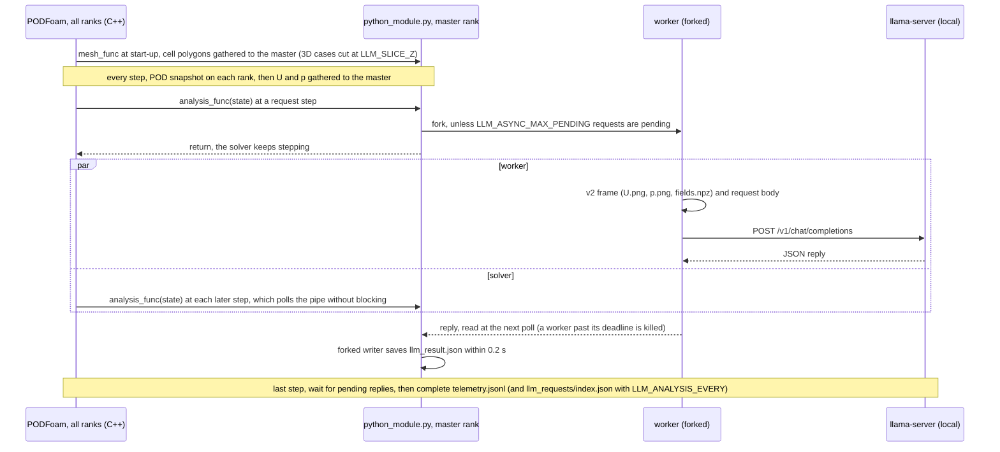

# PythonFOAM: a vision-language observer for OpenFOAM runs

[](https://github.com/seungminyome/PythonFOAM/actions/workflows/tests.yml)
[](https://github.com/seungminyome/PythonFOAM/actions/workflows/evidence.yml)


[](LICENSE)

[Latest report](docs/results-20261028.md) · [All reports](#reports-and-evidence) · [How to run](Solver_Examples/PODFoam/llm_demo/README.md) · [GPU nodes](Solver_Examples/PODFoam/llm_demo/hpc/README.md) · [Korean](https://github.com/seungminyome/PythonFOAM-Korean)

This fork of [PythonFOAM](https://github.com/argonne-lcf/PythonFOAM) adds an
optional observer to the PODFoam example. During an OpenFOAM run the solver
hands its state to Python, which draws |U| and p and asks a vision-language
model served locally by [llama.cpp](https://github.com/ggml-org/llama.cpp) to
describe the pictures, either while the solver waits or while it keeps
stepping. The answers are recorded, and nothing from the model goes back into
the solver. The repository measures how well such models read solver fields,
what the requests cost the run, and how the answers compare with simple
numbers computed from the arrays.

 

*The two v2 pictures the running solver sent to Gemma 4 12B at step 250 of a
developed backward-facing-step flow (t = 0.10125 s): |U| and p, each on its
own colour scale, plotted window x 0 to 0.12 m, y 0 to 0.04 m.*

## Results

A position counts as right when it lies within 10 % of the plotted range of
the true cell. The constant baseline is the score of the best single answer
given to every picture. v1 is the solver's original picture, |U| above p in
two panels with axes in metres; v2, shown above, draws one field per
picture, with axes in percent of the plotted range and a grid line every
10 %; v2own is v2 with each picture of a sequence on its own colour scale.
Unless noted, the case is a 2D laminar flow over a backward-facing step.

| Test | Models, pictures | Result | Constant baseline | Report |
|---|---|---|---|---|
| Fastest flow and lowest pressure, start-up states (first 3 ms), 48 pictures with random windows, three window seeds | Gemma 4 12B, 26B-A4B, 31B, Qwen3.5-35B-A3B; v2 (v1) | 45 to 48 of 48 per seed (v1: 2 to 17) | 7 to 10 | [October 22, continued](docs/results-20261022-live.md) |
| The same, 140 pictures of 35 developed-flow states | the same models; v2 | fastest flow 106 to 121, lowest p 130 to 139 | 16, 17 | [October 22, continued](docs/results-20261022-live.md) |
| Running solver, 11 `describe` requests, each with its own window | Gemma 4 12B; v2 | fastest flow 9, lowest p 10 of 11 | 4, 4 | [October 22, continued](docs/results-20261022-live.md) |
| Running solver, a `describe` request every 250 steps over 24,000 steps | Gemma 4 12B; v2 | fastest flow 65, lowest p 89 of 96 | 53, 65 | [October 27](docs/results-20261027.md) |
| Peak-speed / lowest-pressure trend over three snapshots, 45 sequences | Gemma 4 12B; v2own (v1) | 32 / 28 of 45 (v1: 14 / 15); peak speed right in 29 of the 30 sequences where it changed by at least 2 % | 15 / 20 | [October 27](docs/results-20261027.md) |
| Unstable or not: three frames ending 1 to 10 steps before a crash (27 triples) or from a run that ended (27) | Gemma 4 12B, 26B-A4B, 31B, Qwen3.5-35B-A3B; v2own | 30 to 33 of 54 | 27; rules on the arrays: 33 (peak \|U\| growth), 38 (cell-to-cell jump) | [October 28](docs/results-20261028.md) |
| Cost, one request in flight every 250 steps | Gemma 4 12B | +0.7 % wall time per step against the same run without requests, which drew the same pictures; 2,016 of 2,016 written files identical | | [October 27](docs/results-20261027.md) |
| Cost, two requests in flight every 50 steps | Gemma 4 12B, two server slots | +3.2 % wall time, about 0.1 s per request as with one in flight; 2,520 of 2,520 written files identical | | [October 28](docs/results-20261028.md) |

With v2 pictures every model in the table beat the constant baseline in
every position test, and Gemma 4 12B did so from a running solver over
24,000 steps. Most fastest-flow misses in the developed flow name another
spot with at least 90 % of the largest speed. Over the 24,000-step run the answered
lowest-pressure position follows the spot as it moves between vortex cores,
with a correlation of 0.78 in x. With the solver's v1 pictures no model did
clearly better than the constant baseline in the trend test.

As 4-bit files with the image-token setting llama.cpp recommends for them,
Qwen3.5-35B-A3B and 27B placed the fastest flow of the developed flow in 133
and 128 of 140 pictures, more often than any Gemma model; the two model
families ran with different files and settings. On a second geometry, the
laminar flow past a cylinder (`offsetCylinder`), the three Gemma models placed
the fastest flow in 32 to 39 of 40 windows against a constant baseline of 8;
the lowest pressure, a small spot beside a large dark wake, 31B found in 38
and 12B in 18. Gemma 4 E2B, the model of the CPU path below, placed an
isolated fastest-flow spot in 4 of 32 synthetic v1 pictures and 11 of 32 v2
pictures, against a constant baseline of 5.

In the instability test every model said `unstable` for the triples that end
one step before a crash, where the field has already blown up; none warned
more than 5 steps ahead. A rule on the peak |U| growth does as well as the
best model, and one on the cell-to-cell jump does better.

## How it works

PODFoam calls `mesh_func` once at start-up with the cell geometry and
`analysis_func` after every time step with the step's residuals, Courant
number, continuity error and the cell values of U and p. Both are optional:
a module with only the upstream `snapshot_func` and `svd_func` still
works. In a parallel run the mesh and the fields are gathered to the master
rank, which alone calls the observer; the POD snapshot and SVD stay per rank.
A 2D case is drawn with one polygon per cell from its `empty` patch; a 3D mesh
is cut by OpenFOAM's `cuttingPlane` at z = `LLM_SLICE_Z` (by default the
middle of the z range), and v2 pictures draw each cut cell as its own
polygon. The asynchronous path (`LLM_ASYNC=1`) with v2 pictures:



| Setting | Default | GPU solver runs |
|---|---|---|
| `LLM_MODE` | `observe`: numbers and the v1 picture | `describe`: positions of the fastest flow and the lowest pressure; `sequence`: trend words over two or three snapshots |
| `LLM_IMAGE_STYLE` | `v1` | `v2` |
| `LLM_ASYNC` | `0`: the solver waits for the reply or the deadline, 120 s | `1` |
| `LLM_ANALYSIS_STEP`, `LLM_ANALYSIS_EVERY` | one request at step 5 | one request at a chosen step, or a `describe` request every N steps |
| `LLM_ASYNC_MAX_PENDING` | 1 | 1 or 2 |
| `LLM_MODEL` | Gemma 4 E2B Q4_0 | Gemma 4 12B QAT |

Verification scripts compare every written file with the same run without
requests, the frames' arrays with the written fields, and each request body
with the request builder of the picture tests applied to the frame on disk,
byte for byte. All settings are in
[llm_demo/README.md](Solver_Examples/PODFoam/llm_demo/README.md).

## Quick start

Unit tests and evidence hashes, without OpenFOAM or a model (125 tests, about 80 s):

```bash
pip install -r Solver_Examples/PODFoam/llm_demo/requirements.txt
make test          # or: cd Solver_Examples/PODFoam/llm_demo && python3 -m unittest
make evidence      # every evidence file matches its manifest hash
```

On a workstation with OpenFOAM v2106 (about 3.4 GB of disk for the model
files, a few GB of RAM), the synchronous five-case suite with Gemma 4 E2B on
the CPU exercises the coupling, the deadlines and the verification:

```bash
cd Solver_Examples/PODFoam
./validation/run_v2106.sh        # bridge check; its passed run is the reference case
./llm_demo/setup_runtime.sh      # Gemma 4 E2B Q4_0, image projector, llama.cpp b11429
python3 llm_demo/runtime.py start
./llm_demo/run_demo.sh           # builds PODFoam, runs the five cases, verifies
python3 llm_demo/runtime.py stop
```

On a Slurm GPU node, with OpenFOAM v2212 in an Apptainer image and
llama-server on the node's GPU, `async_v2.slurm` runs the asynchronous suite
with v2 pictures and Gemma 4 12B, and `periodic_v2.slurm` the run with a
request every N steps and the same run without requests. Site lines, the Gemma
licence, the bridge validation inside the image and the developed flow the
runs start from (`LLM_LONG_START`) are in
[llm_demo/hpc/README.md](Solver_Examples/PODFoam/llm_demo/hpc/README.md).

```bash
export HF_TOKEN=hf_... POD_LLM_RUNTIME=$PWD/llm-runtime-12b
bash Solver_Examples/PODFoam/llm_demo/hpc/setup_12b.sh   # llama.cpp b11429 (CUDA), Gemma 4 12B QAT
export POD_REFERENCE_RUN=<pod-v2212.XXXXXX> LLM_LONG_START=<developed case>/0.1
sbatch --account=<account> --partition=<partition> Solver_Examples/PODFoam/llm_demo/hpc/async_v2.slurm
POD_SUITE_RUN=<pod-llm-async.XXXXXX of a PASSed async_v2.slurm run> \
  sbatch --account=<account> --partition=<partition> Solver_Examples/PODFoam/llm_demo/hpc/periodic_v2.slurm
```

## Limitations

- Gemma 4 E2B does not give usable answers. Gemma 4 12B misreads most
  peak-speed changes under 2 % and misses a small pressure extreme next to a
  large region of similar colour, such as the cylinder's; the other models
  tested also miss clear speed changes. Only positions and trend words are
  scored; the descriptions are not.
- The instability set has a flaw: each request states the frames' times, and
  the time between frames alone separates the two classes.
- The same request on the same node gives the same answer. On another GPU the
  text and some positions change, but not the number of positions within
  10 %.
- Tested on 2D laminar flows and one extruded 3D case, where no model has read
  a slice picture; on 2 MPI ranks without a model request; with up to two
  requests in flight.
- Each request's record is written by a forked writer with a 0.2 s budget, so
  that the solver never waits longer. In the run with two requests in flight,
  one of 118 answered requests has no record.

## Next

1. A model on slice pictures of a developed 3D flow.
2. The instability test with equally spaced frames, without the frame times in
   the request, and with numeric warnings (peak growth, cell-to-cell jumps)
   computed in the callback next to the model's answer.
3. The observer hooks, MPI gather, 3D slice, request builder, asynchronous and
   periodic paths and tests as a contribution to PythonFOAM.

## Reports and evidence

Each report gives the setup, hardware and code revision of its runs, the
later ones in a Records section ([October 28](docs/results-20261028.md#records),
[October 27](docs/results-20261027.md#records),
[October 22, continued](docs/results-20261022-live.md#records)). Every
evidence folder has a hash manifest, checked by `make evidence` and in CI;
the [evidence index](docs/evidence/README.md) lists each folder with its run
and code.

- [October 28](docs/results-20261028.md): two requests in flight, 3D slices, instability test, telemetry written during the run, trend words computed in the callback ([downloads](https://github.com/seungminyome/PythonFOAM/releases/tag/tests-2026-10-28))
- [October 27](docs/results-20261027.md): trend reading, a second geometry (cylinder), 4-bit Qwen, a request every 250 steps, repeatability, MPI ([downloads](https://github.com/seungminyome/PythonFOAM/releases/tag/tests-2026-10-27))
- [October 22, continued](docs/results-20261022-live.md): v2 pictures from the running solver with 12B, random windows, a developed flow, Qwen models ([downloads](https://github.com/seungminyome/PythonFOAM/releases/tag/pod-insitu-v2-2026-10-22))
- [October 22](docs/results-20261022.md): picture-reading test, seven Gemma 4 models from E2B to 31B, two picture styles ([downloads](https://github.com/seungminyome/PythonFOAM/releases/tag/picture-test-2026-10-22))
- [October 20](docs/results-20261020.md): asynchronous runs, one-snapshot and sequence replays, E2B on the CPU ([downloads](https://github.com/seungminyome/PythonFOAM/releases/tag/pod-insitu-async-2026-10-20))
- [October 19](docs/results.md#same-replay-with-gemma-4-12b-on-a-gpu-2026-10-19): the October 17 paired requests sent to Gemma 4 12B on a GPU node ([evidence](docs/evidence/2026-10-19-12b/README.md))
- [October 17](docs/results.md): synchronous conditions and the paired image/no-image replay, E2B on the CPU; [repeat on October 19](docs/results.md#repeat-on-2026-10-19) ([downloads](https://github.com/seungminyome/PythonFOAM/releases/tag/pod-insitu-tests-2026-10-17))
- [October 13](docs/results-20261013.md): first five-case run with the image path

[Changelog](CHANGELOG.md) · [Korean repository](https://github.com/seungminyome/PythonFOAM-Korean) and its [Pages site](https://seungminyome.github.io/PythonFOAM-Korean/)

## Repository layout

```
Solver_Examples/PODFoam/   PODFoam (OpenFOAM v2106, also built in v2212) with the observer hooks
                           (PythonCreate.H, PythonAnalysis.H, PythonGather.H, PythonSlice.H)
  validation/              bridge check: ten steps, SVD round trip, verify.py
  llm_demo/                callback (python_module.py), llama-server client, v1 and v2 pictures,
                           request builder, case runners and verification, picture tests, unit tests
  llm_demo/hpc/            Slurm scripts for the GPU nodes
docs/                      dated reports, evidence with hash manifests, the Pages site (index.html)
.github/workflows/         tests.yml (unit tests, Python 3.10 and 3.12), evidence.yml (hashes, links)
```

Other directories (`APMOSFoam`, `AEFoam`, `PINNFoam`, `TurbulenceModel_Examples`,
`Handson_Examples`) are unchanged from upstream.

## Acknowledgements and license

This extends the PODFoam example of [PythonFOAM](https://github.com/argonne-lcf/PythonFOAM)
(Argonne National Laboratory). The original description and setup notes are in
the [project reference](docs/upstream-project.md). The model is served with
[llama.cpp](https://github.com/ggml-org/llama.cpp). The [license](LICENSE) is unchanged.
