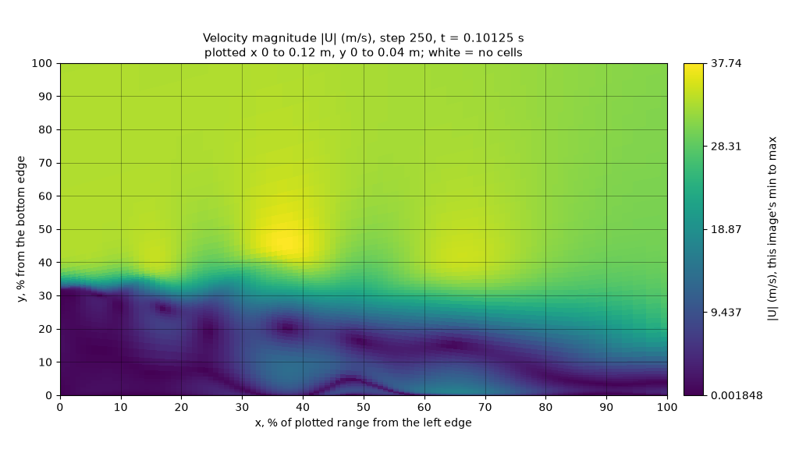
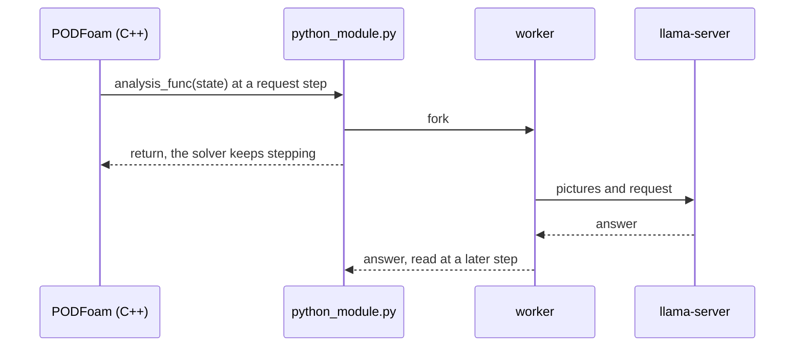

# PythonFOAM: a vision-language observer for OpenFOAM runs

[](https://github.com/seungminyome/PythonFOAM/actions/workflows/tests.yml)
[](https://github.com/seungminyome/PythonFOAM/actions/workflows/evidence.yml)


[](LICENSE)

[Results page](https://seungminyome.github.io/PythonFOAM/) · [Latest report](docs/results-20261030.md) · [How to run](Solver_Examples/PODFoam/llm_demo/README.md) · [GPU nodes](Solver_Examples/PODFoam/llm_demo/hpc/README.md) · [Korean](https://github.com/seungminyome/PythonFOAM-Korean)

This fork of [PythonFOAM](https://github.com/argonne-lcf/PythonFOAM) adds an
optional observer to the PODFoam example. During an OpenFOAM run the solver
hands its state to Python, which draws |U| and p and asks a vision-language
model served locally by [llama.cpp](https://github.com/ggml-org/llama.cpp) to
describe the pictures. The answers are recorded with the arrays they came
from, and nothing from the model goes back into the solver. The repository
measures how well such models read solver fields and what the requests cost
the run.

 

*The two v2 pictures the running solver sent to Gemma 4 12B at step 250 of a
developed backward-facing-step flow (t = 0.10125 s).*

## Features

- A Python hook after every time step (`analysis_func`) and one at start-up
  (`mesh_func`); modules with only the upstream functions still work.
- Two picture styles: the solver's two-panel picture (v1), or one field per
  picture with axes in percent of the plotted range (v2).
- Request modes `observe` (the step's numbers and its v1 picture), `describe`
  (positions of the fastest flow and the lowest pressure) and `sequence`
  (trends over two to six snapshots, at most three with v2).
- Synchronous or asynchronous requests, at one step or every N steps
  (`describe`, v2), with up to eight in flight.
- MPI runs (fields gathered to the master rank) and 3D meshes (a plane slice
  in v2 pictures).
- Verification against the same run without requests; 156 unit tests that
  need neither OpenFOAM nor a model.

## Results

Gemma 4 12B with v2 pictures: positions within 10 % of the plotted range of
the true cell, constant baseline (the best single answer) in brackets.

| Test | Right |
|---|---|
| Fastest flow / lowest pressure, 140 random-window pictures of a developed flow | 108 / 130 (16 / 17) |
| The same in one window, every 250 steps of a running solver (+0.7 % wall time beyond drawing the pictures) | 65 / 89 of 96 (53 / 65) |

More tests and models: [results page](https://seungminyome.github.io/PythonFOAM/).

## How it works

With `LLM_ASYNC=1`, at a request step the callback forks a worker that draws
the step's pictures and posts the request to llama-server; the solver keeps
stepping, and the answer is read at a later step and recorded.



## Requirements

- OpenFOAM v2012, v2106, v2212 or 8; `async_v2.slurm` and `periodic_v2.slurm`
  run v2212 in an Apptainer image.
- Python 3.10 to 3.12 (solver runs: 3.10 and 3.11) with numpy and
  matplotlib, and scipy for the v1 pictures of 3D cases.
- llama.cpp b11429 and a vision model in GGUF format: Gemma 4 E2B Q4_0 on a
  CPU (about 3.4 GB of files) or Gemma 4 12B QAT on a GPU (about 8 GB with
  the CUDA build of llama.cpp). The Gemma licence applies; no token is needed.

## Quick start

Unit tests and evidence hashes, without OpenFOAM or a model (156 tests, about 110 s):

```bash
pip install -r Solver_Examples/PODFoam/llm_demo/requirements.txt
make test
make evidence      # every file in a manifest matches its hash
```

With an OpenFOAM sourced, the synchronous five-case suite with Gemma 4 E2B on
the CPU exercises the coupling, the deadlines and the verification. The solver
links to the Python named here:

```bash
export PYTHON=<python>    # default: python3 on PATH
export PATH=$(dirname "$PYTHON"):$PATH
export LD_LIBRARY_PATH=$(dirname "$PYTHON")/../lib:$LD_LIBRARY_PATH   # if not the system Python
cd Solver_Examples/PODFoam
./validation/run_v2106.sh        # bridge check; its passed run is the reference case
./llm_demo/setup_runtime.sh      # Gemma 4 E2B Q4_0, image projector, llama.cpp b11429
python3 llm_demo/runtime.py start
python3 llm_demo/runtime.py standalone   # optional: one request with a synthetic plot
./llm_demo/run_demo.sh           # builds PODFoam, runs the five cases, verifies
python3 llm_demo/runtime.py stop
```

On a Slurm GPU node, `async_v2.slurm` runs the asynchronous suite with v2
pictures and Gemma 4 12B (`async_v2_sweep.slurm` adds the describe sweep), and
`periodic_v2.slurm` the run with a request every N steps and the same run
without requests. The rest is in
[llm_demo/hpc/README.md](Solver_Examples/PODFoam/llm_demo/hpc/README.md).

```bash
export POD_LLM_RUNTIME=$PWD/llm-runtime-12b PYTHON=<python>
bash Solver_Examples/PODFoam/llm_demo/hpc/setup_12b.sh   # llama.cpp b11429 (CUDA), Gemma 4 12B QAT
export SIF=<of2212.sif> POD_REFERENCE_RUN=<pod-v2212.XXXXXX> LLM_LONG_START=<developed case>/0.1
sbatch --account=<account> --partition=<partition> Solver_Examples/PODFoam/llm_demo/hpc/async_v2.slurm
POD_SUITE_RUN=<pod-llm-async.XXXXXX of a PASSed async_v2.slurm run> \
  sbatch --account=<account> --partition=<partition> Solver_Examples/PODFoam/llm_demo/hpc/periodic_v2.slurm
```

## Settings

| Setting | Default | GPU solver runs |
|---|---|---|
| `LLM_MODE` | `observe` | `describe` or `sequence` |
| `LLM_IMAGE_STYLE` | `v1` | `v2` |
| `LLM_ASYNC` | `0`: the solver waits for the reply or the deadline, 120 s | `1` |
| `LLM_ANALYSIS_STEP`, `LLM_ANALYSIS_EVERY` | one request at step 5 | one request at a chosen step, or a `describe` request every N steps |
| `LLM_ASYNC_MAX_PENDING` | 1 | 1 or 2 |
| `LLM_MODEL` | Gemma 4 E2B Q4_0 | Gemma 4 12B QAT |
| `POD_SLICE_Z` | 3D cases: the middle of the z range | – |

All settings are in [llm_demo/README.md](Solver_Examples/PODFoam/llm_demo/README.md).

## Outputs

In the case directory:

- `llm_observation/step-NNNNNN/`: the v2 pictures and arrays of one time step
  (`U.png`, `p.png`, `fields.npz`, `readable-metadata.json`). v1 writes
  `state.png`, `fields.npz` and `image-metadata.json` into
  `llm_observation/`, the earlier frames of a v1 sequence into
  `step-NNNNNN/`.
- `llm_request.json`, `llm_request_body.json`, `llm_response.json` and
  `llm_result.json`: the request, the exact body sent, the server's reply and
  the result (status, parsed answer, timings). With `LLM_ANALYSIS_EVERY`,
  each request has its own folder in `llm_requests/`, listed in
  `llm_requests/index.json`.
- `telemetry.jsonl`: one line per time step.
- `llm_errors.jsonl`: the callback's own errors; the solver does not stop.

## Limitations

- Only positions and fixed-vocabulary words are scored. Gemma 4 E2B gives no
  usable answers.
- Tested on 2D laminar flows, one extruded 3D case, 2 MPI ranks without a
  model request and up to two requests in flight. No model has read a slice
  picture. No model suite ran on v2012 or 8.
- No model warned of a crash more than 5 steps ahead.
- Wrong setup: 31B 67 of 80, others 41 to 45, constant answer 40, peak |U| rule
  56; without two runs, 31B 55 and the rule 56 of 64.

## Documentation and reports

- [How to run and all settings](Solver_Examples/PODFoam/llm_demo/README.md),
  [GPU nodes](Solver_Examples/PODFoam/llm_demo/hpc/README.md),
  [bridge validation](Solver_Examples/PODFoam/validation/README.md).
- [Results page](https://seungminyome.github.io/PythonFOAM/): the main
  results and all reports, with evidence links and downloads.
- The latest reports: [October 30](docs/results-20261030.md) (OpenFOAM versions,
  upstream's PODFoam, wrong-setup test), [October 28](docs/results-20261028.md)
  (two requests in flight, 3D slices, instability test),
  [October 27](docs/results-20261027.md) (trend reading, a cylinder flow, a
  request every 250 steps).
- [Evidence index](docs/evidence/README.md) (every folder has a hash
  manifest, checked in CI) · [Changelog](CHANGELOG.md) ·
  [Korean repository](https://github.com/seungminyome/PythonFOAM-Korean).

The observer is in `Solver_Examples/PODFoam/` (the `Python*.H` hooks) and its
`llm_demo/` folder; the other example directories are unchanged from upstream.

## Citation

If you use the observer, please cite PythonFOAM and this repository:

```bibtex
@article{maulik2022pythonfoam,
  title   = {PythonFOAM: In-situ data analyses with OpenFOAM and Python},
  author  = {Maulik, Romit and Fytanidis, Dimitrios K. and Lusch, Bethany and
             Vishwanath, Venkatram and Patel, Saumil},
  journal = {Journal of Computational Science},
  volume  = {62},
  pages   = {101750},
  year    = {2022},
  doi     = {10.1016/j.jocs.2022.101750}
}

@software{yome2026observer,
  author = {Yome, Seungmin},
  title  = {PythonFOAM: a vision-language observer for OpenFOAM runs},
  year   = {2026},
  url    = {https://github.com/seungminyome/PythonFOAM}
}
```

## Acknowledgements

This extends the PODFoam example of [PythonFOAM](https://github.com/argonne-lcf/PythonFOAM)
by Argonne National Laboratory; its original description and setup notes are
in the [project reference](docs/upstream-project.md). The models are served
with [llama.cpp](https://github.com/ggml-org/llama.cpp); the model weights
are not part of this repository and come with their own licences. The GPU
and CPU-node runs in the reports used the MedicineBow cluster of the
University of Wyoming Advanced Research Computing Center.

## License

The PythonFOAM open-source [license](LICENSE) of UChicago Argonne, LLC
applies unchanged.
