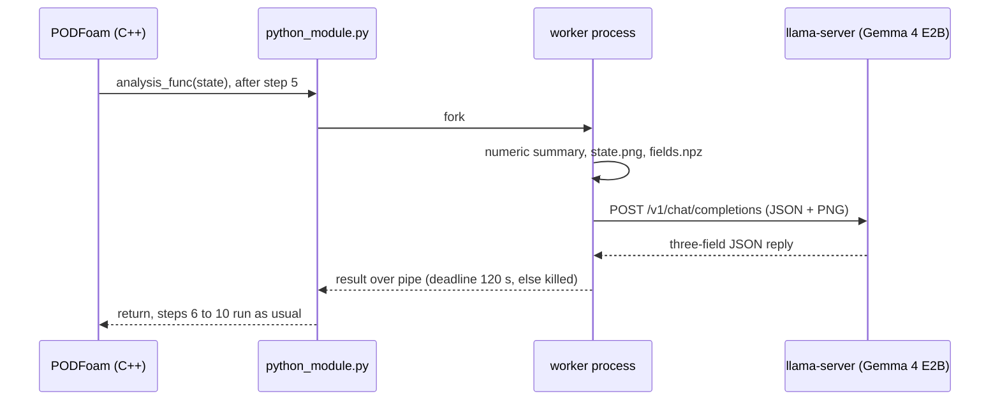

# PythonFOAM + Gemma 4 E2B: reading solver state during a run

[](https://github.com/seungminyome/PythonFOAM/actions/workflows/tests.yml)
[](https://github.com/seungminyome/PythonFOAM/actions/workflows/evidence.yml)


[](LICENSE)

[Test report](docs/results.md) · [Evidence](docs/evidence/2026-10-17/README.md) · [How to run](Solver_Examples/PODFoam/llm_demo/README.md) · [Korean](https://github.com/seungminyome/PythonFOAM-Korean)

During a PODFoam run, a callback sends one step's numbers and a velocity/pressure
image to Gemma 4 E2B running on the local CPU, stores the answer and lets the
solver continue. That much works. Nothing from the model goes back into the
computation. The answers themselves are not yet reliable, and the solver stalls
while it waits for them.


*The image sent at step 5 of the October 17 run: |U| on top, kinematic pressure p below (640x360, one polygon per cell).*

## Quick start

Unit tests, no OpenFOAM or model needed (about 10 s):

```bash
pip install -r Solver_Examples/PODFoam/llm_demo/requirements.txt
make test          # or: cd Solver_Examples/PODFoam/llm_demo && python3 -m unittest
make evidence      # every evidence file matches its manifest hash
```

Full run (OpenFOAM v2106, about 3.4 GB of disk for the model files, a few GB of RAM):

```bash
cd Solver_Examples/PODFoam
./validation/run_v2106.sh        # bridge check; its passed run is the reference case
./llm_demo/setup_runtime.sh      # Gemma 4 E2B Q4_0, image projector, llama.cpp b11429
python3 llm_demo/runtime.py start
./llm_demo/run_demo.sh           # builds PODFoam, runs the five cases, verifies
python3 llm_demo/runtime.py stop
```

Details and environment variables: [llm_demo/README.md](Solver_Examples/PODFoam/llm_demo/README.md).

## Implementation



- A Python callback added to PODFoam (OpenFOAM v2106). Right after a chosen
  time step it sends residuals, Courant number, continuity error, an SVD summary
  and a PNG of that step's |U| and p to a local llama.cpp server (Gemma 4 E2B
  Q4_0 with image projector) and stores the response. "Step 5" in this document
  is the fifth of the ten time steps (t = 5×10⁻⁷ s), the default; set
  `LLM_ANALYSIS_STEP` to change it.
- If the server is absent or slow, control returns to the solver within a fixed
  deadline.
- A verification script checks that all ten steps completed, that the 45 saved
  field files are identical to the baseline, that logs match the records, and
  that the image hash matches the request body.
- The tested code is revision `23089bb`. Later commits change documentation,
  evidence and repository layout only.

## Measurements (2026-10-17, run `pod-llm-demo.LRfJBN`)

Eight-core CPU, 7.7 GiB RAM, no GPU; llama-server on 4 threads, llama.cpp
b11429, context 2048. 20,540 cells, time step
10⁻⁷ s, ten steps. Each condition was run once.

| Condition | Result | Steps | Files equal to baseline | Callback time |
|---|---|---:|---:|---:|
| No model request | baseline | 10 | - | 0.493 s |
| Numbers + image | answer stored | 10 | 45 / 45 | 78.256 s |
| Numbers only | answer stored | 10 | 45 / 45 | 39.672 s |
| Connection refused | error stored, run continues | 10 | 45 / 45 | 0.509 s |
| Server made to stall (4 s deadline) | timeout stored, run continues | 10 | 45 / 45 | 4.013 s |

Callback time is measured in C++ from just before the Python analysis call to
just after it returns. Of the 78.256 s in the image condition, rendering took
0.438 s and waiting for the model 77.560 s.

Using the saved step-5 state, the model was asked three paired times (six
requests) with the question, numbers and settings fixed and only the PNG added
or removed. The maximum speed, 82.53 m/s, was in the input for both conditions;
its location was not. The reference is cell 12090 at (0.0005, 0.0127) m.

| Condition | Claimed (x, y) m | In-plane error | Outcome |
|---|---|---:|---|
| Numbers only | (0.6012, 0.1143) | 60.92 cm | wrong in all 3 |
| Numbers + image | (0.5, 0.1143) | 50.97 cm | wrong in all 3 |

The numbers-only answers copied the domain's x and y upper bounds from the
input as the location. The image answers were about 10 cm closer and still
wrong.

## Open problems

1. Answer accuracy. All six answers on one state gave a wrong location. No other
   state has been tested, so whether the image helps cannot be said yet.
2. Synchronous wait. The solver stalls for about 78 s during an image request.
   There is no asynchronous path yet.
3. Cost measurement. Replayed requests took 13–56 s, but prompt-cache reuse
   varied between requests, so the extra cost of the image cannot be separated.
4. Scope. One short serial fluid case. MPI, 3D, long runs, the 12B model and
   the contribution of the SVD summary have not been tested.

## Next steps

1. Repeat the paired comparison at several time steps and on other flow states.
2. Implement an asynchronous path with frozen snapshots and a bound on pending
   requests.
3. Re-measure the time cost of the image under controlled cache conditions.
4. Run the same five conditions and the same paired replay with the 12B QAT
   GGUF on a machine with more memory (a GPU node), after checking that the
   llama.cpp build can load its image projector. Improve the image input (axes,
   grid marks).

## Repository layout

```
Solver_Examples/PODFoam/      PODFoam solver (OpenFOAM v2106) with the callback hooks
  validation/                 bridge check: ten steps, SVD round trip, verify.py
  llm_demo/                   callback module, llama-server client, five-case runner,
                              paired replay benchmark, unit tests, requirements.txt
docs/results.md               October 17 test report
docs/evidence/2026-10-17/     raw requests, responses, logs, verification, hash manifest
docs/evidence/2026-10-13/     earlier run (pod-llm-demo.SwwR2e) and its report, docs/results-20261013.md
docs/evidence/check_manifest.py  verifies every evidence file against its manifest (also run in CI)
docs/upstream-project.md      original PythonFOAM README (other solvers, Docker, build notes)
.github/workflows/            tests.yml (unit tests, Python 3.10 and 3.12), evidence.yml (hashes, links)
CHANGELOG.md, CITATION.cff, Makefile
```

Other directories (`APMOSFoam`, `AEFoam`, `PINNFoam`, `TurbulenceModel_Examples`,
`Handson_Examples`) are unchanged from upstream.

## More

- [Test report](docs/results.md): conditions, measurements, limitations
- [Evidence](docs/evidence/2026-10-17/README.md): raw requests and responses, logs, verification results, hash manifest
- [Full run download](https://github.com/seungminyome/PythonFOAM/releases/tag/pod-insitu-tests-2026-10-17): all saved results of the five conditions and the executed sources (no model weights)
- [Changelog](CHANGELOG.md)
- [Korean repository](https://github.com/seungminyome/PythonFOAM-Korean) and its [illustrated results](https://seungminyome.github.io/PythonFOAM-Korean/)

## Citing

`CITATION.cff` is in the root; GitHub's "Cite this repository" button formats it.
Cite the code revision you used (`23089bb` for the October 17 results).

## Acknowledgements and license

This extends the PODFoam example of [PythonFOAM](https://github.com/argonne-lcf/PythonFOAM)
(Argonne National Laboratory). The original description and setup notes are in
the [project reference](docs/upstream-project.md). The model is served with
[llama.cpp](https://github.com/ggml-org/llama.cpp). The [license](LICENSE) is unchanged.
