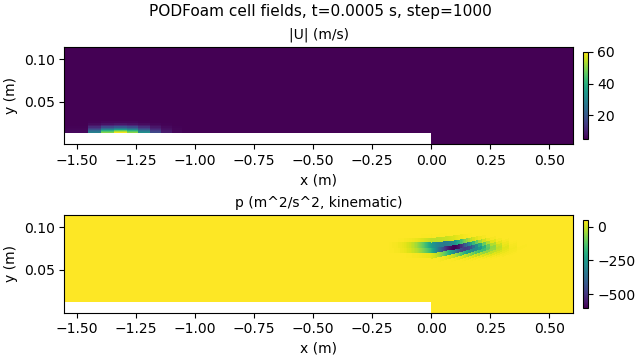
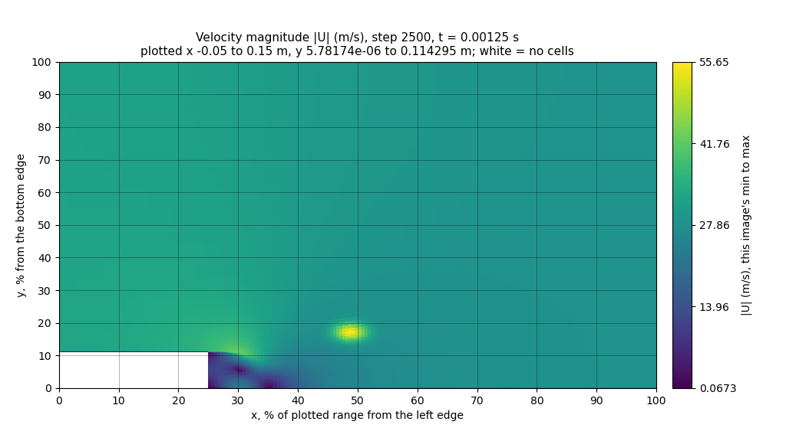
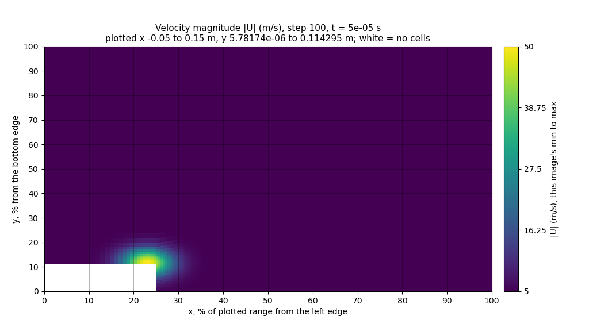

# October 22 picture-reading test: seven Gemma 4 models, two picture styles

Code `58e00d9` · Slurm job 24756981 on MedicineBow, one NVIDIA RTX A6000 (49,140 MiB) · llama.cpp b11429 (commit `d812350`) built from source with CUDA · 2026-10-22, model runs 01:20 to 02:43 MDT

[README](../README.md) · [Evidence](evidence/2026-10-22-picture-test/README.md) · [How the requests are made](../Solver_Examples/PODFoam/llm_demo/hpc/README.md#picture-reading-test-run-2026-10-22) · [Downloads](https://github.com/seungminyome/PythonFOAM/releases/tag/picture-test-2026-10-22) · [Korean](https://github.com/seungminyome/PythonFOAM-Korean/blob/main/docs/results-20261022.md)

No solver ran. The same 308 prepared requests went to each of seven Gemma 4
models in turn: E2B in three forms, E4B, 12B, 26B-A4B and 31B, all 4-bit, with
`--n-gpu-layers 99`, temperature 0, and the prompt cache off for the new sets.
All but six requests ask about pictures: of a synthetic field, of a saved
PODFoam state, or of a saved state with a peak and a dip planted in it (the six
are the October 17 numbers-only requests). The pictures are drawn either the way
the solver draws them now (v1) or in a new style meant to be read (v2). Every
answer was scored against an answer key the models did not see. All 2,156
replies came back in the required JSON form.

## The two pictures

v1 (`pod_image.py`, what the solver sends): |U| and p as two panels of one
640x360 image, axes in metres, a colour bar per panel with round-number ticks,
the colour range of each panel from its own minimum to maximum. v2
(`readable_image.py`): one field per image, 1024x576, both axes in percent of
the plotted range with a grid line every 10 %, the colour bar labelled with
five values from the minimum to the maximum.

 

*The same synthetic case in v1 (left, both fields) and v2 (right, the |U| image; p is a second image).*

The prompts differ with the picture: both ask for positions in percent of the
plotted range, but the v1 prompt describes metre axes and a stretched vertical
axis, the v2 prompt percent axes and the grid. A v2 snapshot request carries
two images and had about 1,040 prompt tokens, against about 560 for v1 (one
image of 106 tokens).

## Where is the fastest flow, where is the lowest pressure?

- Synthetic: 32 pictures, 16 of the whole domain and 16 of a window around the
  step, each with one bright |U| spot and one dark p spot at chosen places.
- Planted: 32 pictures of 4 saved states (steps 1000, 2500, 4000 and 5500),
  8 per state, half whole domain and half window. Each has one narrow |U| peak
  (1.3 times the state's maximum) and one narrow p dip added at its own place,
  at least 15 % of the plotted range away from the step corner.

An answer counts when it is within 10 % of the plotted range of the true spot
(distance in the plane of x and y percent). One fixed answer for each plotted
range would get 5 of the synthetic and 6 of the planted pictures.

| Model | Synthetic, fastest flow, v1 / v2 | Synthetic, lowest p, v1 / v2 | Planted, fastest flow, v1 / v2 | Planted, lowest p, v1 / v2 |
|---|---:|---:|---:|---:|
| E2B Q4_0, Q8_0 projector | 4 / 11 | 3 / 6 | 2 / 10 | 3 / 6 |
| E2B Q4_0, BF16 projector | 4 / 8 | 2 / 7 | 1 / 12 | 2 / 7 |
| E2B QAT | 3 / 6 | 3 / 5 | 5 / 9 | 2 / 3 |
| E4B QAT | 9 / 15 | 3 / 2 | 4 / 15 | 4 / 5 |
| 12B QAT | 9 / **32** | 13 / **32** | 5 / **32** | 9 / 25 |
| 26B-A4B QAT | 17 / **32** | 9 / **32** | 15 / 31 | 5 / 20 |
| 31B QAT | 18 / **32** | 15 / **32** | 17 / **32** | 9 / 24 |
| One fixed answer | 5 | 5 | 6 | 6 |

All counts are out of 32.

With v2, 12B, 26B-A4B and 31B put the fastest flow within 10 % in every
synthetic picture and in 31 or 32 of the 32 planted pictures; the median
distance was 1.2 to 2.6 % of the plotted range. With v1 the same models got 5
to 18 of 32. Item by item, none of the three had a fastest-flow position right
with v1 and wrong with v2.

The lowest pressure in the planted pictures was harder: 25, 20 and 24 of 32.
Every one of these misses (7, 12 and 8) named a point within 10 % of where the
same saved state, with nothing planted, has its own lowest pressure: the step
corner. So does the one 26B-A4B miss for the fastest flow. In the pictures
below, the planted dip near the top (x about 20 %, y 90 %) is the darkest spot
by construction; the state's own low pressure behind the step is a larger,
slightly lighter patch. 12B, 26B-A4B and 31B all named that patch (x 27 to
31 %, y 5 to 12 %), and all three found the planted |U| peak.

 

*Planted picture, step 2500, window around the step: |U| (left) and p (right).*

E2B in all three forms got 1 to 12 of 32 (one fixed answer: 5 or 6).
Changing its projector from Q8_0 to BF16 with the same weights moved a
position count by at most 3 of 32. The QAT form has other weights and Google's
own projector file (also BF16); it differed from the BF16 form by at most 4
and from the Q8_0 form by at most 5, in both directions. E4B found the fastest
flow in 15 of 32 v2 pictures in both sets, the lowest pressure in 2 and 5.

## Does the peak rise or fall?

18 synthetic sequences of three times, in the window around the step: peak
speed 40 to 60, 60 to 40 or 50.0 to 50.4 m/s; lowest pressure -400 to -800,
-800 to -400 or -600 to -604 m²/s²; the bright spot stays or moves; every
combination once. Three styles: v1; v2 with one colour scale shared by all
times, the change to be judged from the colours; v2own, the v2 pictures with
each image's own colour scale, the change to be judged from the maxima and
minima printed on the colour bars. The v2 and v2own prompts differ only in the
sentences about the colour scale and what to judge from. One fixed answer would
get 6, 6 and 9 of 18.

| Model | Peak speed, v1 / v2 / v2own | Lowest pressure, v1 / v2 / v2own | Spot stays or moves, v1 / v2 / v2own |
|---|---:|---:|---:|
| E2B Q4_0, Q8_0 projector | 9 / 7 / 6 | 6 / 6 / 7 | 11 / 9 / 9 |
| E2B Q4_0, BF16 projector | 8 / 6 / 7 | 8 / 6 / 8 | 14 / 9 / 9 |
| E2B QAT | 8 / 7 / 6 | 7 / 5 / 9 | 9 / 9 / 9 |
| E4B QAT | 7 / 11 / 10 | 9 / 6 / 11 | 11 / 14 / 12 |
| 12B QAT | 17 / 13 / 12 | 16 / 13 / 12 | 17 / 18 / 18 |
| 26B-A4B QAT | 15 / 11 / 12 | 13 / 11 / 16 | 17 / 18 / 18 |
| 31B QAT | 18 / 16 / 12 | 17 / 17 / 12 | 18 / 17 / 18 |
| One fixed answer | 6 | 6 | 9 |

All counts are out of 18.

The six flat designs of each field are a flaw of the test. The answer key
calls a change of less than 2 % roughly constant; the flat designs change by
0.8 % (speed) and 0.7 % (pressure), and the prompt did not give the 2 %
threshold. In v2own the top of the |U| colour bar reads 50 at the first time
and 50.4 at the third, and the three larger models called all six speeds
increasing and, except 26B-A4B (4 of 6 right), the pressures more negative: a
correct reading of the numbers, scored wrong. The v1 colour bar has ticks at
round numbers only, and in v2 a 0.8 % change does not show in the colour, so
there these designs were mostly called roughly constant.

 

*A flat design in v2own: the colour bar ends at 50 (left, first time) and 50.4 (right, third time).*

On the 12 designs with a clear change:

| Model | Peak speed, v1 / v2 / v2own | Lowest pressure, v1 / v2 / v2own |
|---|---:|---:|
| 12B QAT | 12 / 7 / 12 | 12 / 7 / 12 |
| 26B-A4B QAT | 12 / 5 / 12 | 7 / 5 / 12 |
| 31B QAT | 12 / 10 / 12 | 11 / 11 / 12 |

All counts are out of 12.

With the numbers on the colour bar (v2own), the three larger models got all
12 clear changes right in both fields. With one shared colour scale (v2) they
called many clear changes roughly constant. Whether the bright spot stayed or
moved, they answered right in 17 or 18 of 18 in every style. The E2B forms got
5 to 9 of the 12 clear changes right in each field and style.

## Saved flow states without anything planted

- `flow-describe`: 12 saved states, every 500 steps up to step 6000, each
  drawn whole and as the window (24 pictures).
- `flow-sequence`: seven triples of saved states between steps 250 and 6000,
  in both views (14 sequences).
- `oct20-replay`: the 24 requests of October 20 (18 positions, 6 sequences),
  v1 pictures.

In these states the fastest flow and the lowest pressure stay at the step
corner, and the trend words are the same in nearly every sequence. The peak
speed falls in 10 of the 14 sequences (by 3.8 to 29.8 %) and changes by less
than 2 % in the other 4. The lowest pressure becomes less negative in all 14
(by 5 to 58 %). The bright spot stays in place in all 14. One fixed answer
therefore gets 24 of 24 positions, 18 of 18 on the October 20 requests and 10,
14 and 14 of 14 sequence words, so a right answer here shows little; a wrong
one still counts against the model.

| Model | Fastest flow, v1 / v2 | Lowest p, v1 / v2 | Peak speed, v1 / v2 / v2own | Lowest pressure, v1 / v2 / v2own |
|---|---:|---:|---:|---:|
| 12B QAT | 4 / 22 | 4 / 22 | 8 / 4 / 12 | 7 / 0 / 3 |
| 26B-A4B QAT | 0 / 24 | 1 / 24 | 8 / 7 / 12 | 1 / 3 / 11 |
| 31B QAT | 4 / 24 | 7 / 24 | 8 / 5 / 11 | 4 / 1 / 12 |
| One fixed answer | 24 | 24 | 10 | 14 |

Positions out of 24 (`flow-describe`), trend words out of 14 (`flow-sequence`).

- With v2, 26B-A4B and 31B placed both extremes within 10 % in all 24
  pictures and 12B in 22, which is the level of the fixed answer; with v1 they
  placed the fastest flow in 0 to 4 of 24, and on the October 20 requests in
  0 to 8 of 18.
- With numbers on the colour bars (v2own), all three were right on every one
  of the 10 speed falls; their misses were among the four sequences that change
  by less than 2 %, which they called decreasing. The lowest pressure was right
  for 31B in 12, 26B-A4B in 11 and 12B in only 3 of 14: 12B answered more
  negative 11 times.
- With one shared colour scale (v2) they called the pressure roughly constant
  in 12 (12B), 8 (26B-A4B) and 13 (31B) of 14.
- On the October 20 sequence requests (v1) all three called the falling peak
  speed right in 6 of 6, and the pressure trend in 3, 0 and 6 of 6.

All counts are in [report.md](evidence/2026-10-22-picture-test/report.md).

## The October 17 pairs

The six paired requests of October 17 (numbers only, numbers + image) were
sent with and without the prompt cache. E2B in all three forms gave, in all 12,
the coordinates of the published CPU answers. E4B, 12B, 26B-A4B and 31B wrote
in `observations`, which the scorer reads, that the position is unknown, in all
12, so none was scored. With the image, 12B, 26B-A4B and 31B still put the high
speed near x = 0 m in `possible_interpretation`, in all 6; 31B adds y = 0.0 m,
which is 1.3 cm from the true cell at (0.0005, 0.0127) m. E4B gave no position.
The automatic checker raised flags on 6 of 12 E4B, 11 of 12 26B-A4B and 6 of
12 31B answers (mostly for mentions of a force balance, and for 31B a "stable"
flow read from the SVD energy); they were not reviewed by hand.

## Time and memory

| Model | Parameters | Weights | GPU memory when ready | Median per request | All 308 requests |
|---|---:|---:|---:|---:|---:|
| E2B Q4_0, Q8_0 projector | 4.6 B | 2.8 GB | 2,644 MiB | 1.01 s | 5.4 min |
| E2B Q4_0, BF16 projector | 4.6 B | 2.8 GB | 3,054 MiB | 1.00 s | 5.3 min |
| E2B QAT | 4.6 B | 3.3 GB | 2,960 MiB | 1.01 s | 5.2 min |
| E4B QAT | 7.5 B | 5.1 GB | 4,378 MiB | 1.31 s | 6.9 min |
| 12B QAT | 11.9 B | 7.0 GB | 7,966 MiB | 2.86 s | 14.6 min |
| 26B-A4B QAT | 25.2 B | 14.4 GB | 15,892 MiB | 2.18 s | 11.5 min |
| 31B QAT | 30.7 B | 17.6 GB | 20,128 MiB | 6.33 s | 32.3 min |

Parameters and weight sizes are as the server reported them, without the
projector, which is a separate file. The memory figure was read once, when the
server first reported ready and before any request, so it is not a peak; the
GPU has 49,140 MiB. For E2B (Q8_0 projector and QAT) and E4B it is below the
size of the weights alone, so part of the weights was not in GPU memory
(llama.cpp keeps the input embedding tables in host memory; the logs do not
show the split). 26B-A4B is a mixture-of-experts model (about 4 B parameters
active per token, the A4B of its name) and was faster than 12B. The seven model
runs took 83 minutes, model loading included; the check of the test set and of
the model hashes ran before them, and the results were on GitHub at 02:45 MDT.

## What this shows and what it does not

Shown, in replays of saved pictures drawn as v2: the three larger models point
to an isolated bright spot within a few percent (32 of 32 synthetic pictures,
31 or 32 of 32 planted ones) and to an isolated dark spot in the synthetic
pictures (32 of 32), less reliably in the planted ones (20 to 25 of 32). They
tell whether a spot moved. With numbers on the colour bars they read the clear
rises and falls of the synthetic sequences (12 of 12) and the falling peak
speed of the saved flow (10 of 10). E2B, the model the solver uses now, does
not, in either style: over all position questions it was within 10 % in 67 of
388 answers and got 140 of 306 trend words right, fewer than one fixed answer
would (176 and 195).

Not shown:

- Reading the flow reliably. In the saved states a fixed answer does as well;
  in the planted pictures the larger models named the step corner for the
  lowest pressure in 7 to 12 of 32 although a darker spot was elsewhere; 12B
  read the saved flow's pressure trend the wrong way round in 11 of 14
  sequences even with numbers on the colour bars.
- Use inside the solver. The solver still draws v1 pictures, and no solver
  ran in this job.
- Which part of v2 helps. The picture (one field per image, size, percent
  axes, grid, colour-bar labels), the prompt and its JSON note, and the number
  of image tokens (about five times) all changed together.
- Repeatability. One GPU type, one answer per request at temperature 0. The
  planted pictures share their background: 8 per saved state.
- Trend scoring. The 2 % threshold of the key was not in the prompt (above).

## Next

1. Let the solver callback draw v2 pictures and run the asynchronous cases
   with 12B or 26B-A4B on a GPU node; OpenFOAM v2106 is not installed there yet.
2. Ask the trend question with the threshold in the prompt, and add flows in
   which the fastest flow or the lowest pressure moves.

## Records

[Evidence](evidence/2026-10-22-picture-test/README.md): the report the job
wrote; per model and set every parsed answer with its score and timings
(`metrics.jsonl`), and the replies to the October 17 pairs; the answer key; the
server logs; and an independent re-scoring that recomputes every count in the
report from the answers and the key and checks its fixed-answer scores and item
comparisons (518 cells and lines, none differ). The two archives are in the
[release](https://github.com/seungminyome/PythonFOAM/releases/tag/picture-test-2026-10-22):
the input bundle (the 308 request bodies, with the pictures inside them, and
the answer key) and the job's results (every raw reply).
