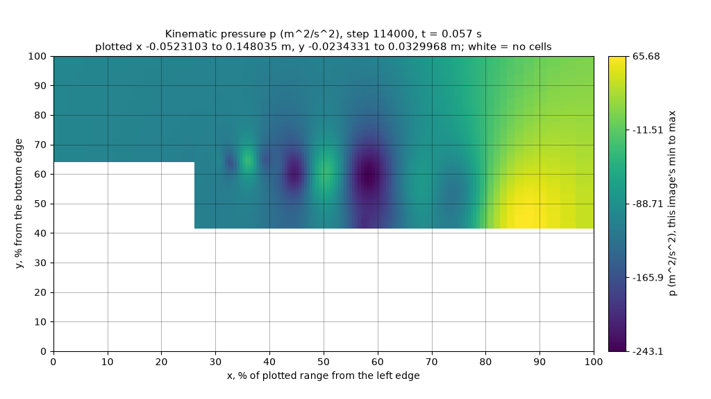
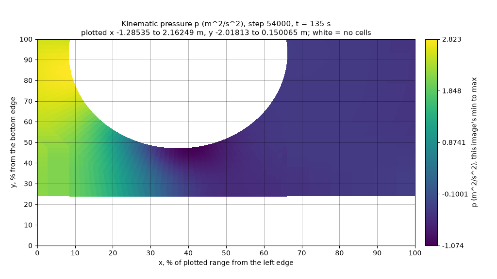
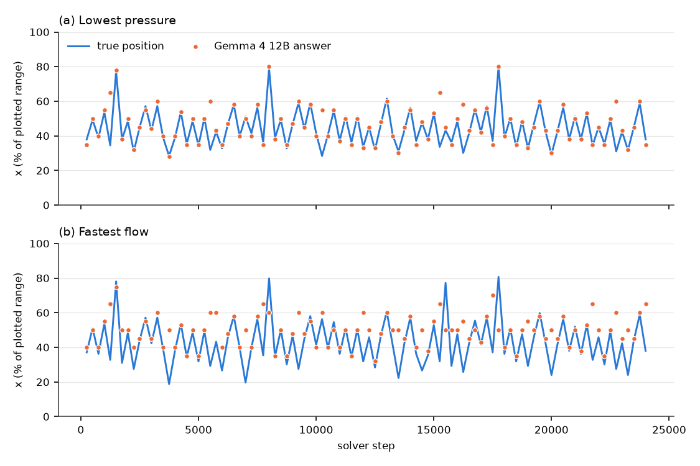

# October 27: trend reading, a second geometry and periodic requests

MedicineBow, 2026-10-27: NVIDIA A30 and L40S GPU nodes and CPU nodes · llama.cpp b11429 (commit `d812350`) · jobs and code: [Records](#records)

[README](../README.md) · [Evidence: picture tests](evidence/2026-10-27-picture-tests/README.md) · [Evidence: solver runs](evidence/2026-10-27-solver/README.md) · [How to run](../Solver_Examples/PODFoam/llm_demo/README.md#trend-test-on-a-developed-flow-sequence_testpy) · [Downloads](https://github.com/seungminyome/PythonFOAM/releases/tag/tests-2026-10-27) · [Korean](https://github.com/seungminyome/PythonFOAM-Korean/blob/main/docs/results-20261027.md)

In a test of whether the peak speed and the lowest pressure rise, fall or
stay roughly constant over three snapshots of a developed backward-facing-step
flow, no model did clearly better than the constant baseline with the
solver's original pictures, while every model read about twice as many trends
right with each field drawn on its own colour scale and its extremes printed.
Gemma 4 12B then read 29 of the 30 clear changes in peak speed but missed
most changes under 2 %; the other models also missed clear changes, and
Gemma 4 31B, given the extremes as numbers without pictures, read every clear
change. As 4-bit files with the image-token setting llama.cpp recommends,
Qwen3.5-35B-A3B and Qwen3.5-27B placed the fastest flow in 133 and 128 of 140
v2 pictures of the developed flow, more often than any Gemma model (106 to
113; constant baseline 16), though the two families ran with different files,
settings and GPUs. On a second geometry, the flow past a cylinder, the three
Gemma models placed the fastest flow in 32 to 39 of 40 v2 pictures (constant
baseline 8), but only the largest, 31B, reliably found the small
lowest-pressure spot beside the cylinder (38 of 40).

Sending a `describe` request every 250 steps of a 24,000-step run cost 0.7 %
of wall time beyond drawing the pictures (one pair of runs) and left every
written file unchanged; Gemma 4 12B placed the lowest pressure within 10 % in
89 of 96 requests (constant baseline 65), followed it as it moved between
vortex cores, and in its wrong answers named a near-equal second candidate.
On the same node the same request gave the same answer; on another GPU it
gave other text and some other positions, but the same number within 10 %.
The observer also ran on 2 MPI ranks.

A position counts as right when it lies within 10 % of the plotted range of
the true cell. The constant baseline is the score of the best single answer
given to every picture (in the trend test, to every item). v1 is the solver's
original two-panel picture of |U| and p; v2 draws one field per picture, with
axes in percent of the plotted range and a grid line every 10 %; v2own is v2
with each picture of a sequence on its own colour scale.

## Reading change between snapshots

Each item is three snapshots of the developed flow over the backward-facing
step (1 to 3 ms apart) in one random window. The model returns three words:
the peak-speed trend (increasing, decreasing, roughly constant), the
lowest-pressure trend (more negative, less negative, roughly constant) and
whether the fastest spot moves. In the answer key a trend is roughly constant
when the relative change from the first to the last snapshot stays within
2 %, and the fastest spot moves when it shifts by more than 5 % of the
plotted range. The 45 items were chosen to cover the speed-pressure
combinations: 15 of each speed word; 20, 18 and 7 of the pressure words. Each
item was asked in five forms:

| Form | What the model gets |
|---|---|
| v1 | the solver's two-panel pictures, one per snapshot, and the October 20 prompt |
| v2own | one picture per field and snapshot, each on its own colour scale; the prompt says to compare the colour-bar numbers (October 22) |
| v2own + thresholds | the same, with the key's 2 % and 5 % rules in the prompt |
| v2own + numbers | the same, plus each snapshot's largest \|U\| and lowest p in the text sent with the pictures |
| numbers only | the numbers and the rules, no pictures |

Right answers out of 45, the Gemma models on an NVIDIA A30 and Qwen on an
NVIDIA L40S:

| Model | v1 speed / p | v2own | + thresholds | + numbers | numbers only |
|---|---:|---:|---:|---:|---:|
| Gemma 4 12B | 14 / 15 | 32 / 28 | 36 / 26 | 33 / 28 | 32 / 28 |
| Gemma 4 26B-A4B | 16 / 19 | 31 / 36 | 29 / 34 | 33 / 33 | 36 / 37 |
| Gemma 4 31B | 18 / 20 | 32 / 33 | 32 / 31 | 37 / 41 | 35 / 42 |
| Qwen3.5-35B-A3B Q8_0 | 15 / 18 | 31 / 32 | 34 / 35 | 32 / 28 | 34 / 33 |
| Constant baseline | 15 / 20 | 15 / 20 | 15 / 20 | 15 / 20 | 15 / 20 |

The same counts on the items with a clear change (at least 2 %; 30 items for
speed, 38 for pressure):

| Model | v1 | v2own | + thresholds | + numbers | numbers only |
|---|---:|---:|---:|---:|---:|
| Gemma 4 12B | 4 / 12 | 29 / 28 | 29 / 25 | 23 / 28 | 23 / 24 |
| Gemma 4 26B-A4B | 12 / 19 | 25 / 33 | 27 / 33 | 29 / 32 | 27 / 33 |
| Gemma 4 31B | 7 / 17 | 20 / 33 | 26 / 30 | **30 / 36** | **30 / 38** |
| Qwen3.5-35B-A3B Q8_0 | 2 / 16 | 17 / 32 | 20 / 34 | 20 / 28 | 21 / 31 |

 

 

*One item, first and last snapshot (t = 0.051 and 0.057 s). Peak speed falls 5.4 %, the lowest pressure rises from −356 to −243 m²/s². Top, v1: one colour scale per panel, no numbers at the extremes; 12B answered increasing and more negative. Bottom, v2own pressure pictures: the colour bars print each picture's minimum; 12B answered decreasing and less negative.*

- With v1 pictures no model did clearly better than the constant baseline.
  One picture per field on its own colour scale, with the extremes printed on
  the colour bar, about doubles both counts.
- With v2own pictures most of 12B's speed errors are on the 15 items without
  a clear change, which it nearly never called roughly constant (3 times in
  45). Stating the 2 % rule in the prompt raised 12B's count on those 15
  items from 3 to 7 and did not help the pressure trend.
- With v2own pictures 31B and Qwen3.5 read 20 and 17 of the 30 clear speed
  changes, so most of their errors are on clear changes; 26B-A4B read 25,
  and 9 of its 14 errors are on changes under 2 %.
- Given the extremes as numbers, 31B read all 30 clear speed changes, with or
  without the pictures, and 36 of 38 clear pressure changes with the
  pictures, 38 of 38 without. The other models still made errors with the
  numbers in front of them (12B 23 of 30 clear speed changes, Qwen3.5 20 to
  21), so they do not reliably compare two numbers against a 2 % rule.
- The fastest spot moves in 39 of 45 items, so the constant baseline scores
  39 on the third word, which is not informative here.

## 4-bit Qwen with the recommended image tokens

In the [October 22 window test](results-20261022-live.md) the Qwen models ran
as Q8_0 files (Gemma as 4-bit files) and with fewer image tokens than the
minimum llama.cpp recommends for them. Here the three larger Qwen models ran
as Q4_K_M files with `--image-min-tokens 1024` and `--image-max-tokens 1024`
(context 8192) on NVIDIA L40S GPUs, on the same two random-window sets: 48
pictures of the start-up states (window seed 1) and 140 of the developed
flow. v2 pictures; positions within 10 %:

| Model | Start-up states, window seed 1 (48): fastest / lowest p | Developed flow (140): fastest / lowest p | Median time per request (developed flow) |
|---|---:|---:|---:|
| Qwen3.5-35B-A3B Q4_K_M | 48 / 46 | **133 / 137** | 2.0 s |
| Qwen3.5-27B Q4_K_M | 48 / 48 | 128 / 136 | 6.1 s |
| Qwen3-VL-32B Q4_K_M | 38 / 46 | 112 / 134 | 7.6 s |
| *October 22:* Gemma 4 12B / 26B-A4B / 31B | 45 to 47 / 47 to 48 | 106 to 113 / 130 to 139 | 2.4 to 7.3 s |
| *October 22:* Qwen3.5-35B-A3B Q8_0, 256 image tokens | 47 / 46 | 121 / 134 | 2.1 s |
| Constant baseline | 7 / 7 | 16 / 17 | |

- With these settings Qwen3.5-35B-A3B and Qwen3.5-27B place the fastest flow
  in the developed flow more often than any Gemma model; on the lowest
  pressure all are close.
- The Gemma rows ran as QAT Q4_0 files with an image-token limit of 256,
  which the Gemma requests do not reach, and context 4096, on an NVIDIA RTX
  A6000, so the two families differ in files, settings and GPU. For Qwen two
  things changed at once, the 4-bit files and the image-token setting, so the
  gain is not attributed to either. With `--image-max-tokens 1024` alone the
  two Qwen3.5 Q8_0 files already reached 47 to 48 of 48 on the start-up
  states on October 22.
- A Qwen request is about 2,590 prompt tokens with these settings, a Gemma
  request about 1,050.

## A second geometry: flow past a cylinder

The second flow is the `offsetCylinder` case of the OpenFOAM-9 tutorials
(laminar, `pimpleFoam`), run from t = 0 to 150 s on its mesh (1,800 cells)
and on one twice as fine in each direction (7,200 cells). PODFoam with the
callback draws its frames on both meshes; since the empty patch of this case
lists both faces of every cell, `pod_image.py` keeps one polygon per cell.
The test uses ten states of the fine run (t = 100 to 145 s), four random
windows each, drawn as v1 and v2 pictures; the models ran on an NVIDIA A30.
Positions within 10 %, out of 40:

| Model | Fastest flow, v1 / v2 | Lowest p, v1 / v2 | v2 median distance, fastest / lowest p |
|---|---:|---:|---:|
| Gemma 4 12B | 10 / 32 | 1 / **18** | 4.7 / 14.4 % |
| Gemma 4 26B-A4B | 9 / 39 | 3 / 26 | 3.4 / 8.1 % |
| Gemma 4 31B | 3 / 35 | 7 / 38 | 4.6 / 4.0 % |
| Constant baseline | 8 | 8 | |

*Cylinder, t = 135 s, one window (white: the cylinder and, below, outside the domain). The lowest pressure is the dark spot on the cylinder's lower side at x 41 %, y 47 %; 12B answered x 85 %, y 50 %, behind the cylinder, where p is 40 % of the minimum.*

- For the fastest flow the v2 pictures work on this geometry too.
- The lowest pressure is a small spot on the edge of the cylinder, next to a
  large dark wake. Each of 12B's 22 misses named a point with only 15 to 61 %
  of the lowest pressure (8 behind the cylinder, 4 at its lower rear, 10
  below it;
  [cylinder_misses.py](evidence/2026-10-27-picture-tests/cylinder_misses.py)).
- The ten states differ by at most 6×10⁻⁵ m/s in |U| and have their two
  extremes in the same cells; the flow is steady, so the 40 pictures are 40
  windows on one field.

## A request every 250 steps

The solver ran 24,000 steps of 5×10⁻⁶ s from t = 0.1 s of the developed flow
with `LLM_MODE=describe` and `LLM_ANALYSIS_EVERY=250`: a request with v2
pictures every 250 steps, at most one in flight, answered by Gemma 4 12B QAT
on an NVIDIA A30. The reference is the same run without requests on the same
node, which drew the same 96 pictures. The plotted window is fixed (x 0 to
0.12 m, y 0 to 0.04 m).

| | Without requests | With 96 requests |
|---|---:|---:|
| Requests answered | | 96 of 96 |
| Written files identical to the other run | 2,016 of 2,016 | |
| Wall time per step | 0.05794 s | 0.05833 s (+0.7 %) |
| Callback time at a request step | | at most 0.017 s; 6.8 s at the last step, which waits for the pending reply by design |
| Reply arrived after | | 85 to 144 steps (model time 4.2 to 5.3 s); the last request is waited for at the last step |
| Bytes back over the pipe per request | | 4,009 to 4,461 |
| Request body | | 212 to 230 kB |
| Solver process memory (PSS) at the low point of each 250-step cycle, first to last quarter of the run | 131 → 216 MiB | 173 → 243 MiB |
| llama-server memory (RSS) | | 12.5 GiB |
| Fastest flow within 10 % | | 65 of 96 (constant baseline: 53) |
| Lowest pressure within 10 % | | 89 of 96 (constant baseline: 65) |

*x position of (a) the lowest pressure and (b) the fastest flow at each of the 96 requests (one every 250 steps from t = 0.1 s), in percent of the plotted range: true position (line) and Gemma 4 12B's answer (dots).*

- The solver ran at its own pace while the model answered. The difference in
  wall time is the cost of the requests beyond drawing the pictures, measured
  on one pair of runs on a node where three other jobs of this study ran at
  the same time.
- The lowest pressure jumps between vortex cores from one request to the next
  (x from 28 to 80 %); the answers follow it with correlation 0.78 in x
  ([tracking.py](evidence/2026-10-27-solver/periodic/tracking.py)). The
  fastest flow is followed less (0.35): 93 of the 96 answers lie between 35
  and 65 % while the true spot reaches 19 and 81 %.
- Of the 31 fastest-flow answers more than 10 % off, 27 named a spot with at
  least 90 % of the largest speed in the plotted range (all at least 86 %);
  of the 7 lowest-pressure misses, 5 named a spot at least 90 % as low
  ([misses.py](evidence/2026-10-27-solver/periodic/misses.py)). In this flow
  the wrong answers pick a near-equal second candidate, unlike 12B's pressure
  misses on the cylinder.
- The case's POD module keeps 250 snapshots and clears them at each SVD, so
  the solver process swings by up to 430 MiB within every 250-step cycle. At
  the low point of each cycle it grows by about the same amount without and
  with requests (+85 and +70 MiB over the run), so the requests do not add to
  it. About 32 MiB of the growth is the callback's per-step history, kept for
  `telemetry.jsonl` (1.35 KiB per step); the rest was not traced
  ([memory.py](evidence/2026-10-27-solver/periodic/memory.py)).

## Repeatability across runs and GPUs

The suite of five asynchronous cases and the eleven-request sweep of
October 22, first run on an NVIDIA RTX A6000, were run twice more on one
NVIDIA A30 node:

| | Repeat 1 | Repeat 2 |
|---|---|---|
| Suite verification | PASS | PASS |
| Written flow fields equal to the first run | all | all |
| Request bodies equal to the first run (13) | 13 | 13 |
| Answers equal to the first run in every field | 0 of 13 | 0 of 13 |
| Answers equal to the other repeat | 13 of 13 | 13 of 13 |
| Sweep within 10 %, fastest / lowest p | 9 / 10 of 11 | 9 / 10 of 11 |
| Words right in the `sequence` answer | 3 of 3 | 3 of 3 |

- On the same node the same request gives the same answer, byte for byte. On
  the other GPU the same request bodies gave other text and, in 6 of the 11
  sweep requests, other positions, while the counts within 10 % did not
  change. The `sequence` answer's pressure word was wrong on the A6000 and
  right on the A30.
- The sweep's POD mode files differ from the first run's while its flow
  fields do not; the next section gives the cause.

## MPI and the POD files

In a parallel run the observer gathers the mesh and the fields to the master
rank, and only the master calls `mesh_func` and `analysis_func`; the POD
snapshot and SVD stay per rank. On 2 ranks (scotch decomposition, 600 steps,
frame at step 100, no model) the frame has the same 20,540 cells as the
serial run's, cell centres equal to 4×10⁻¹⁷ m, U within 7.5×10⁻⁴ m/s (of
37 m/s) and p within 0.021 m²/s² (of 335), the differences of a parallel
solve. The [bridge validation](../Solver_Examples/PODFoam/validation/README.md)
passes with the same build.

On October 22 the sweep's POD mode files differed from those of the run with
the model off by up to 10⁻¹¹ of the largest value while U, p and phi were
identical. Six runs of 600 steps without model requests vary the BLAS thread
count and whether a second solver runs at the same time: with 8 threads all
30 mode files differ from a one-thread run, alone or two at once, by at most
1.0×10⁻¹³ (10⁻¹² of the largest value); with one thread all 42 written files
are identical, also two at once. The differences therefore come from the
thread count of the SVD alone.

## Limitations

- Only positions and trend words are scored; the descriptions themselves are
  not.
- Whether a model notices a run going wrong is untested. Nine attempts on the
  step flow with `pimpleFoam` did not produce a picture of one
  ([summary](evidence/2026-10-27-solver/unstable/unstable-summary.json)):
  with upwind convection every run finished, up to a Courant number of 28;
  with central differencing the runs stopped with a floating point exception
  at the first step (Courant number 4.5 and 11) or finished without visible
  oscillation (1.54 and below, judged by eye).
- No 3D case, no run on more than 2 ranks, and no parallel run with a model
  request.
- No run with more than one request in flight.
- No use of the answers is tested; nothing from the model goes back into the
  solver.

## Next

1. Compute the trend words from the arrays in the callback, where they are
   exact, and ask the model only what a picture adds: where the features are
   and what they look like.
2. A 3D case, more ranks, and a parallel run with a request.
3. Write the telemetry as the run goes instead of keeping every step's state,
   and trace the rest of the memory growth.
4. Record a run that diverges slowly (for example through its mesh or time
   step) and test whether a model notices.
5. Offer the hooks, MPI gather, v2 pictures, request builder, asynchronous and
   periodic paths and tests to PythonFOAM as a contribution.

## Records

Slurm jobs on MedicineBow, all on 2026-10-27 between 08:28 and 16:10 MDT:

| Test | Job | Hardware |
|---|---|---|
| Trend test, Gemma 4 12B, 26B-A4B and 31B | 24903974 | NVIDIA A30 |
| Trend test, Qwen3.5-35B-A3B Q8_0 | 24903975 | NVIDIA L40S |
| 4-bit Qwen, start-up states | 24903976 | NVIDIA L40S |
| 4-bit Qwen, developed flow | 24903977 | NVIDIA L40S |
| Cylinder windows | 24903978 | NVIDIA A30 |
| A request every 250 steps, and the same run without requests | 24903264 | NVIDIA A30 |
| Repeat 1 of the October 22 suite and sweep | 24903298 | NVIDIA A30 |
| Repeat 2: the suite, then the sweep | 24903263, 24903755 | NVIDIA A30 |
| MPI, 2 ranks | 24903786 | CPU |
| POD files, six runs | 24903065 | CPU |

The first run of the October 22 suite and sweep was job 24757460 on an NVIDIA
RTX A6000. The cylinder flow runs and the unstable-flow attempts were further
CPU jobs, listed in the two evidence READMEs.

- Code. The picture jobs ran scripts equal to `ab6b943` (every file hashed in
  each job's `sha256.txt`). The trend set was built with `6afbdeb`, the
  cylinder set with code equal to `df72c24`. The periodic run and the repeats
  ran the Python callback of `df72c24`; the repeats compiled PODFoam with
  `df72c24` sources except two files that got the parallel fixes later (the
  runs are serial); the periodic run used the PODFoam binary of October 22.
  The MPI test compiled `df72c24` exactly. Details and the code state of each
  job: [solver evidence](evidence/2026-10-27-solver/README.md#notes).
- New in the code: `LLM_ANALYSIS_EVERY` (a `describe` request every N steps,
  each recorded in its own folder with an index); the trend prompts with
  thresholds and numbers and `sequence_test.py`; the MPI gather
  (`PythonGather.H`); one polygon per cell in `pod_image.py`; `--dt` and
  `--y-span` for the window tests; `--image-min-tokens` and 4-bit Qwen rows
  for the GPU scripts; `run_periodic.py` and `periodic_v2.slurm`;
  `pack_run.py` records sources changed since the build. 95 unit tests.
- [Evidence for the picture tests](evidence/2026-10-27-picture-tests/README.md):
  each job's report, every parsed answer with its score, the answer keys of
  the two new sets, server logs, example pictures, the cylinder runs'
  settings, the cylinder miss analyses, and a recount without the test code that
  reproduces all 38 count rows of the five reports.
- [Evidence for the solver runs](evidence/2026-10-27-solver/README.md): the
  periodic run's summary, request index, logs, telemetry and the tracking,
  miss and memory analyses; the repeats' verifications, answers and hash lists with a
  comparison script; the MPI frame comparison; the POD-file comparison; the
  unstable attempts.
- Downloads ([tests-2026-10-27](https://github.com/seungminyome/PythonFOAM/releases/tag/tests-2026-10-27)):
  the five picture jobs and the two new test sets; the cylinder runs; the
  periodic run without time directories (every request body, reply and frame);
  the MPI and POD-file runs; the unstable attempts (settings and logs).
