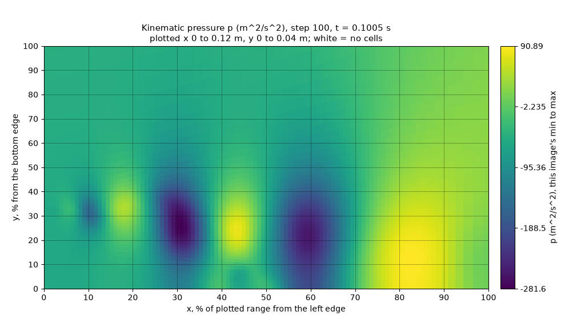

# October 28: two requests in flight, 3D slices and an instability test

MedicineBow cluster, 2026-10-28 · NVIDIA L40S and CPU nodes · llama.cpp b11429 (commit `d812350`) · Slurm jobs and code: [Records](#records)

[README](../README.md) · Evidence: [two in flight](evidence/2026-10-28-inflight/README.md), [callback](evidence/2026-10-28-callback/README.md), [3D slice](evidence/2026-10-28-3d/README.md), [instability test](evidence/2026-10-28-instability/README.md) · [Downloads](https://github.com/seungminyome/PythonFOAM/releases/tag/tests-2026-10-28) · [Korean](https://github.com/seungminyome/PythonFOAM-Korean/blob/main/docs/results-20261028.md)

Two `describe` requests can be in flight at once: each answered request added
about 0.1 s of solver wall time beyond drawing the pictures, as with one in
flight, and all 2,520 written files equalled those of a run without requests.
The callback now writes its telemetry file during the run, so its memory no
longer grows with the run (in a replay of 24,000 recorded states, at most
0.52 MiB of Python heap instead of 31.7 MiB), and the file is byte-identical
to before. The callback also computes the trend words of a `sequence`
request from the arrays, and the observer draws 3D cases through a plane
slice, serially and on 2 ranks. Asked whether three frames of a run show
signs of numerical instability, four vision-language models were right for
30 to 33 of 54 triples, against a constant baseline of 27; rules on the
growth of the peak |U| and of the largest cell-to-cell jump, computed from
the arrays, were right for 33 and 38. The models said `stable` for every
triple from a run that ended. Each said `unstable` for the three triples
ending one step before a crash, where the field had already blown up, and
for 0 to 3 more, none ending more than 5 steps before its crash. In this set
the frame times stated in each request alone separate the two classes.

The constant baseline is the score of the best single answer given to every
picture, or in the instability test to every triple. A position counts as
right when it lies within 10 % of the plotted range of the true cell. A v2
picture shows one field, with axes in percent of the plotted range and a
grid line every 10 %. The answers are recorded, and nothing from the model
goes back into the solver.

## Two requests in flight

Gemma 4 12B, served on an NVIDIA L40S with two slots (`LLM_PARALLEL=2`),
received a v2 `describe` request every 50 steps for 6,000 steps from the
developed flow, with at most two requests pending
(`LLM_ASYNC_MAX_PENDING=2`); a second run, otherwise the same, sent no
requests. The table, computed by
[inflight.py](evidence/2026-10-28-inflight/inflight.py), compares this pair
with the pair of runs in the [October 27 report](results-20261027.md), which
sent one request every 250 steps. Each column is one pair of runs, and the
two pairs ran on different nodes.

| | Two in flight, every 50 steps | One in flight, every 250 steps |
|---|---:|---:|
| Requests planned / answered | 120 / 118 | 96 / 96 |
| Skipped because two were pending | 2 | 0 |
| Sent while another request was pending | 112 | 0 |
| Written files identical to the run without requests | 2,520 of 2,520 | 2,016 of 2,016 |
| Wall time per step, without / with requests | 0.06165 / 0.06363 s (+3.2 %) | 0.05794 / 0.05833 s (+0.7 %) |
| Extra wall time per answered request | 0.101 s | 0.097 s |
| Callback time at a request step, largest (last step excepted) | 0.046 s | 0.017 s |
| Model time, smallest / median / largest | 2.54 / 3.80 / 4.65 s | 4.15 / 4.73 / 5.25 s |
| Fastest flow within 10 % (constant baseline) | 81 of 117 (62) | 65 of 96 (53) |
| Lowest pressure within 10 % (constant baseline) | 106 of 117 (78) | 89 of 96 (65) |

- The runs without requests drew the same pictures, so the extra wall time
  is what the requests cost on top of drawing. With nearly the same cost per
  answered request in both pairs, five times as many requests cost about
  five times as much.
- One answered request, that of step 4100, has no record. The forked writer
  that saves a request's record is stopped after 0.2 s so that the solver
  never waits longer, and step 4167, at which the reply arrived, took
  0.207 s. The request's folder has no `llm_result.json`, although the index
  said `ok`; the solver was not affected. The request index now records
  `record_written` for every request, and `run_periodic.py --summary-only`
  lists such requests and leaves them out of the scores (117 scored).

## Telemetry written during the run

The callback used to keep every step's state until the end of the run, to
write `telemetry.jsonl` at the last step. It now encodes each step's line
when the step arrives and keeps only the first state and the last three; a
forked writer with a 0.2 s deadline appends the lines in batches, every 500
lines or 60 s and at the last step
([callback evidence](evidence/2026-10-28-callback/README.md)).

| | Before | Now |
|---|---:|---:|
| Python heap over the 24,000 recorded states of October 27 (replay, `memory.py`) | 31.7 MiB | at most 0.52 MiB (0.07 MiB after an append) |
| The last step, which writes the file (replay) | 0.699 s | 0.023 s |
| Callback time per ordinary step in PODFoam, median | 0.08 to 0.11 ms | 0.16 to 0.22 ms |
| Steps with an append (steps 500 and 1,000) | – | 13.7 to 22.0 ms |
| `telemetry.jsonl` | | byte-identical in the three solver pairs (1,250 steps; serial `describe`, serial `sequence`, 2 ranks) and in the 24,000-state replay |

- Every written field, frame and request body of the runs with the new
  callback is identical to that of the runs with the old one.
- The file is complete or absent: during the run only `telemetry.jsonl.tmp`
  exists, and it is renamed at the last step. A write that fails is reported
  once in `llm_errors.jsonl`, and the solver does not stop.
- Each ordinary step now costs about 0.1 ms more, because its line is
  encoded in the solver process.

## Computed trend words

For a v2 `sequence` request the callback now computes the three trend words
from the frames' arrays inside the plotted range, with the answer key's
rules: a 2 % relative change for the trends of the peak speed and the lowest
pressure, and 5 % of the range for whether the fastest spot moves. It
records them in `llm_result.json` (`computed_trends`, and
`computed_trends_agreement` when the model answered). In the solver run with
frames at steps 100, 150 and 200 they were `increasing` (+2.44 %),
`more_negative` (−10.9 %) and `moves` (6.92 % of the range), the same as the
picture tests' answer key. No model answered in these runs, so the agreement
field was checked only against a test server. By default the request is
unchanged byte for byte; `LLM_SEQUENCE_PROMPT=t` adds the answer key's
thresholds to the prompt, and `tn` also gives each time's largest |U| and
lowest p.

## 3D cases: a plane slice

For v2 pictures the observer takes one polygon per cell from the `empty`
patch of a 2D case, which a 3D mesh does not have. PODFoam now cuts a 3D
mesh with OpenFOAM's `cuttingPlane` at z = `LLM_SLICE_Z` (by default the
middle of the z range, moved off a plane of mesh points), and the observer
draws each cut cell as its own polygon
([3D evidence](evidence/2026-10-28-3d/README.md)). The test case is the step
case extruded to 8 cells in z, with walls front and back (164,320 cells),
run for 150 steps from the 2D state at t = 0.1 s:

- The slice holds 20,540 cells, one per 2D cell, in the fifth layer.
- On 2 ranks it has the same cells as the serial run: centres equal to
  4.2×10⁻¹⁷ m, polygon vertices identical, U within 2.5×10⁻³ m/s (largest
  component 37.2 m/s) and p within 0.036 m²/s² (largest |p| 282 m²/s²).
- The frame equals the written fields of its step to their 12 digits; all
  63 written files equal those of a run without the observer; the request
  body equals the tested builder applied to the frame.
- A bad `LLM_SLICE_Z`, or a plane that cuts no cells, gives a solver warning
  and a refused request; the runs went on to the end.
- 2D cases are unchanged: the 2D frame and request body equal those of the
  October 27 MPI test file for file, and the bridge validation passes.

*Pressure in the mid slice of the 3D case at step 100: each cut cell is one polygon.*

## Instability test

With central differencing and a larger time step, runs of the step case
crash: in step 27 at Δt = 3×10⁻⁵ s, in step 10 at 4×10⁻⁵ s and, in a longer
run, in step 467 at 2×10⁻⁵ s. Four models were shown three v2 frames of a
run (|U| and p, each picture on its own colour scale, in the window the
solver plots) and asked whether the run shows signs of numerical
instability. The scored set has 27 triples whose last frame is 1 to 10 steps
before a crash and 27 from runs that reached their end time: upwind runs, the
developed flow and a central-differencing run with a small time step
([instability evidence](evidence/2026-10-28-instability/README.md)).

| Answers from | Right of 54 | Crash coming, said `unstable` (of 27) | Run ended, said `stable` (of 27) |
|---|---:|---:|---:|
| Gemma 4 12B | 32 | 5 | 27 |
| Gemma 4 26B-A4B | 30 | 3 | 27 |
| Gemma 4 31B | 33 | 6 | 27 |
| Qwen3.5-35B-A3B Q8_0 | 32 | 5 | 27 |
| Constant baseline | 27 | | |
| Rule: peak \|U\| in the window grows more than 20 % | 33 | 6 | 27 |
| Rule: largest cell-to-cell \|U\| jump grows more than 50 % | 38 | 11 | 27 |

- Every model said `unstable` for the 3 triples whose last frame is the step
  before a crash, where the field has already blown up (largest |U| 84.6 m/s
  to 1.5×10⁴⁰ m/s). Besides those, the models called 0 to 3 more triples
  `unstable`, the earliest ending 5 steps before its crash.
- Every triple a model called `unstable` had its peak |U| grow by 30.8 % or
  more; a rule on that number alone does as well as the best model, and a
  rule on the cell-to-cell jump does better. On this set the pictures added
  nothing beyond the colour-bar numbers.
- The set has a flaw: each request states the frames' times, and the frames
  of the crashed runs are closer together than those of the runs that ended,
  so the time between frames alone separates the two classes (54 of 54).
  Even so, the models said `stable` for most triples from the crashed runs.

## Limitations

- No model has read a slice picture, and neither the picture nor the request
  says that it shows a slice. Only an extruded hexahedral mesh cut by a plane
  normal to z was tested, and only with OpenFOAM v2212.
- Nothing here shows a crash warning earlier than a few steps before the
  crash, from the pictures or from the numbers.
- More than two requests in flight, and the record writer on a slow disk,
  were not tested.

## Next

1. A model on slice pictures of a developed 3D flow.
2. The instability test with equally spaced frames and without the stated
   times, and with numeric warnings (peak growth, cell-to-cell jumps)
   computed in the callback next to the model's answer.
3. A larger budget, or the worker itself, for writing request records.
4. The observer as a contribution to PythonFOAM.

## Records

- Jobs (Slurm, MedicineBow, 2026-10-28). Two requests in flight: 24929296
  (NVIDIA L40S). Callback check: 24929555 and 24929607 (CPU). 3D slice:
  24929463 to 24929629 (CPU); the results are those of 24929629. Instability
  test: 24929408 to 24929534 and 24929764; the flow runs on CPU nodes, the
  models in 24929533 and 24929534 on an NVIDIA L40S.
- Code. Two requests in flight: `2ed6da2` (the job's `git/HEAD`, clean),
  summary rebuilt with `run_periodic.py` of `c85c79c`. Callback: branch
  `callback-telemetry-trends` (`16d665e`, review fixes `b63c990`), merged in
  `5de6abd`. 3D slice: branch `observer-3d` (`07759b0`, `127a1dc`, review fixes
  `5706021`), merged in `eff951b`. Instability test: branch
  `instability-test` (`8d6a10a`, review fixes `660f8c4`), merged in
  `121e89a`. `record_written`: `56646b9`. Each branch was reviewed by an
  independent AI review agent before merging; the reviews' findings were
  fixed on the branches. 125 unit tests. The merged code was built and run once more
  (job 24936949): its 2D and 3D frames and request bodies equal those of the
  earlier runs ([evidence](evidence/2026-10-29-merged-check/README.md)).
- Evidence: [two in flight](evidence/2026-10-28-inflight/README.md),
  [callback](evidence/2026-10-28-callback/README.md),
  [3D slice](evidence/2026-10-28-3d/README.md),
  [instability test](evidence/2026-10-28-instability/README.md), each with a
  hash manifest and the scripts that compute its numbers.
- Downloads ([tests-2026-10-28](https://github.com/seungminyome/PythonFOAM/releases/tag/tests-2026-10-28)):
  the two-in-flight run without time directories (every request body, reply
  and frame), the instability test set and its two jobs' archives. The
  callback and 3D run folders and the flow runs' time directories stay on
  the cluster (paths in the evidence READMEs).
